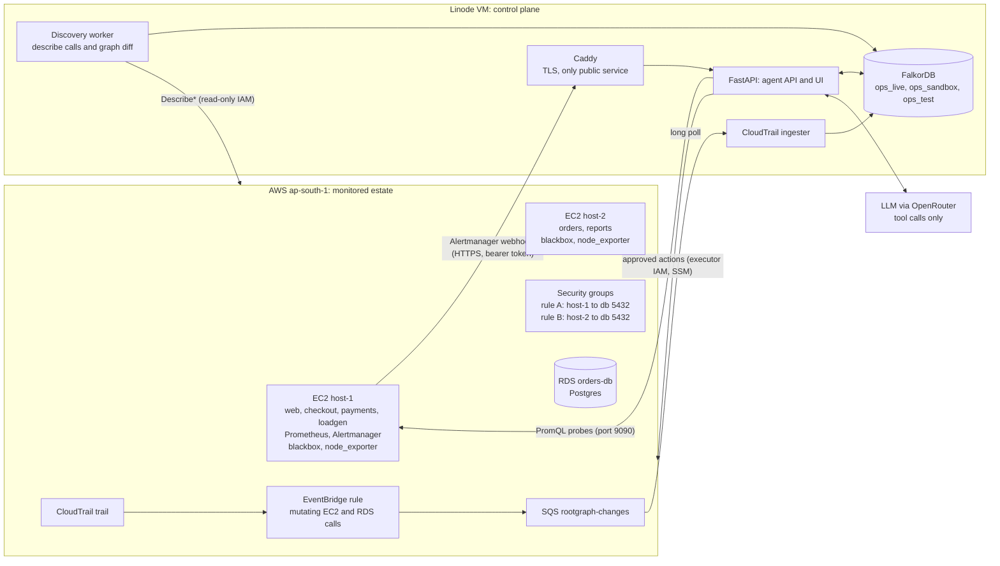

# rootgraph

Many alerts, one cause. The graph decides, the agent investigates and explains, a human acts.

- Live sandbox: https://172-232-86-149.sslip.io
- Repository: https://github.com/guranshdeol/graph-incident-responder
- Tracks entered: Track 01 (Agents That Act on Connected Data) and Track 02 (Agent Memory)

rootgraph watches an AWS estate. When several alerts fire together, it walks the graph upward from the alerting nodes to the resource that explains them, proves the conclusion with the network path and the infrastructure change behind it, proposes a reversible fix from a fixed catalogue, and waits for a human to approve it. Every conclusion comes from a Cypher query that FalkorDB runs. The LLM chooses among typed read tools and writes the explanation; it never writes Cypher and never acts.

## How it differs from Blast Radius

| Blast Radius (organiser demo) | rootgraph |
|---|---|
| Hand-seeded graph | Services are declared in `ingest/services.yaml`. Hosts, databases, networks, security groups and rules are discovered from AWS every 60 s, and resynced before each live investigation. Infrastructure changes are streamed from CloudTrail. Observed-traffic dependencies are not built. |
| Downward: "what breaks if X fails" | Upward: `correlate_alerts` (Q2) ranks the nodes that explain the firing alerts. The downward view exists as the `blast_radius` tool (Q6). |
| Service dependencies only | Services, hosts, networks and security-group rules. `check_path` (Q4) catches "the dependency exists, the network path doesn't". |
| Answers questions | Proposes a fix from a catalogue (`restore_firewall_rule`, `restart_service`) with its blast radius and rollback. Only the Approve button in the UI can execute it. Sandbox execution only writes to the graph. |
| Findings as memory | Incidents, root causes, CloudTrail changes and verified actions are nodes in the graph. `recall_incidents` (Q7) matches them by alert names and candidate resources, and a recalled fix carries its exact parameters. |

## What happens during an incident

1. **Open.** Load the incident's firing alerts (Q13). In live mode, a full discovery resync runs first so the graph-diff `Change` is there even if CloudTrail lags.
2. **Suspects.** `correlate_alerts` (Q2) walks upward from the alerting nodes and keeps the top 5 by coverage.
3. **Paths.** For every `DEPENDS_ON` edge leaving an alerting service or a suspect, run `check_path` (Q4). A broken path adds the firewall that lost a permitting rule in the last 30 minutes (Q10) as a candidate. If no firewall lost one, every firewall on the target is a candidate.
4. **Evidence.** For each candidate: `probe` (healthy, unhealthy, degraded or unknown) and `recent_changes` (Q5, last 30 minutes). A database counts as healthy if any host reaches it.
5. **Memory.** `recall_incidents` (Q7) with the alert names and candidate resources. Matches are shown first.
6. **Score.** The deterministic scorecard from the scoring weights is written as `SUSPECTS` edges (W7).
7. **Explain.** When an LLM is configured, it reads the scorecard and the evidence, and may call up to 6 read tools, each with a `reason`. Its JSON answer goes through the validator. If validation fails, a template sentence built from the top-ranked row is used instead.
8. **Propose.** An action from the catalogue is proposed for the top cause, or one per cause when there are several.
9. **Approve and execute.** A human approves the action. The executor runs it, and the executor's own change is recorded as a `Change` with `by_agent = true`.
10. **Verify and remember.** Verification polls the alerts and probes (every 5 s, up to 120 s). If they clear, the incident is closed with `ROOT_CAUSE`, `EXPLAINED_BY` and `RESOLVED` edges, plus a Finding. If not, the incident is marked failed and surfaced to the human.

**S1 in plain words.** A human revokes the security-group rule that lets host-1 reach `orders-db` on 5432. Alerts fire on payments, checkout and web (`HighErrorRate`), and on the blackbox probe from host-1 to `orders-db` (`DependencyUnreachable`). Coverage alone ranks host-1 first, because it explains the most alerts. The graph and probes overturn that. Host-1 probes healthy. `orders-db` is reachable from host-2, so the database itself is fine. `check_path` from payments to `orders-db` is broken at `sg-db`. The discovery diff recorded the rule's removal as a `Change`, and the CloudTrail `RevokeSecurityGroupIngress` event, with its actor, is linked to `sg-db`. The result is root cause `sg-db` with a `restore_firewall_rule` proposal for the exact rule. A human approves it, the alerts clear, and the incident is closed. In S4 the same fault returns. Recall matches the earlier incident, adds 1.0 to the score of `sg-db`, and pre-fills the restore.

Fixture scores from `tests/test_scenarios.py` (`graph/fixtures/scenarios/`):

| Scenario | Top candidate | Score | Notes |
|---|---|---|---|
| S1 security-group rule revoked | `sg-db` | 6.75 | Runner-up `host-1` probes healthy. |
| S2 CPU hog on host-2 | `i-host2` | 5.0 | `orders` explains only part of the alert set. |
| S3 `payments` stopped | `svc:payments` | 5.0 | No infrastructure change found; proposes `restart_service`. |
| S4 S1 repeated | `sg-db` | 7.75 | Includes +1.0 from a recalled incident. |
| S5 S1 and S3 together | `sg-db` 6.75, `svc:payments` 4.25 | Both causes are shown as "multiple likely causes", with a proposal for each. |

**Does the graph evidence matter?** Same incidents, three rankers ([docs/evaluation.md](docs/evaluation.md), `python -m eval.baseline`):

| Ranker | Correct on S1–S5 |
|---|---|
| Coverage only (the node that explains the most alerts) | 2/5: blames healthy host-1 in S1 and S4, misses `sg-db` in S5 |
| Coverage + hop distance (graph topology, no evidence) | 2/5 |
| rootgraph scorecard (+ probes, network paths, changes, memory) | 5/5 |

S5 is a documented limitation. The scorecard ranks the causes but does not split the alerts between them.

## Live on real AWS

rootgraph ran end to end on a real AWS account on 17 Oct 2026 (Sydney, `ap-southeast-2`; the team's AWS Organization allows only that region). `demo/aws/estate.py up` created the estate; discovery built `ops_live` in 5 s (2 hosts, 1 database, 5 security groups, 7 networks, 5 services, 6 dependencies).

Clean run, measured (incident `INC-2f75fef8`):

| Step | Time (UTC) |
|---|---|
| Rule A revoked (host-1 → orders-db:5432) | 06:58:23 |
| Real Prometheus/Alertmanager alerts open an incident | 06:58:59 (+36 s) |
| Full investigation: root cause = the db security group, 7.75 (broken path + change + memory); host-1 1.0, probe healthy; 2 agent-chosen calls | 06:59:55 |
| Memory: recalled `INC-a994b5d4` (same cause, resolved 10 min earlier) and pre-filled the fix | same report |
| A person approves; the executor re-adds the exact rule (`AuthorizeSecurityGroupIngress` by `rootgraph-executor`, marked `by_agent`) | 07:00:37 |
| Alerts resolved, verification passed, incident closed | 07:01:40 (162 s from incident open) |

On an earlier run, CloudTrail's `RevokeSecurityGroupIngress` (with the actor) reached the graph through EventBridge → SQS in 4 s, and the graph diff recorded the removal 10 s after the change. The live runs also found five bugs the fake-AWS tests could not (webhook blocked behind a slow investigation, re-investigation after approval, repeated notifications opening a second incident, a 120 s verification window that was too short, a duplicate proposal from a late re-investigation); all are fixed, with regression tests (see DECISIONS.md).

The live page is `https://172-232-86-149.sslip.io/live/` (operator token required). How to check everything yourself: [docs/CHECKING.md](docs/CHECKING.md).

## Architecture



| Component | Runs on | Notes |
|---|---|---|
| Demo services (one image: web, checkout, payments, orders, reports) | EC2 host-1, host-2 | Docker Compose. No restart policy, so faults stay until fixed. |
| loadgen, Prometheus, Alertmanager | EC2 host-1 | Prometheus scrapes every 5 s. Blackbox and node_exporter also run on host-2. |
| `orders-db` | AWS RDS (Postgres) | Single-AZ, private, own security group. |
| Caddy, FastAPI API and UI | Linode, Docker Compose | Caddy is the only service published on 0.0.0.0 (ports 80 and 443). |
| FalkorDB | Linode, Docker Compose | Bound to 127.0.0.1 and protected by a password. Reachable only over an SSH tunnel. |
| Discovery worker, CloudTrail ingester | Linode, Compose profile `aws` | Started only once the AWS estate exists. |

The graph model is in [docs/graph.md](docs/graph.md).

## Graph data model

Full model, conventions and every query: [docs/graph.md](docs/graph.md).

**Nodes.** Infrastructure nodes carry the label `Resource` plus a kind label (`Service`, `Compute`, `Database`, `Firewall`, `Network`, `Internet`, `CidrBlock`) and a unique `rid`. Other labels are `Alert`, `Change`, `Incident`, `Action` and `Finding`.

**rid formats.** `svc:<name>`, `i-…` (EC2), `rds:<db-identifier>`, `sg-…`, `vpc-…`, `subnet-…`, `internet`, `cidr:<block>`.

**Key edges.**
- `(Service)-[:DEPENDS_ON {kind, port, weight}]->(Service|Database)`
- `(Service)-[:RUNS_ON {weight}]->(Compute)`
- `(Compute|Database)-[:IN]->(Network subnet)-[:IN]->(Network vpc)`
- `(Firewall)-[:PROTECTS]->(Compute|Database)`
- `(Firewall)-[:ALLOWS_FROM {rule_id, proto, port_from, port_to, active, removed_at}]->(Firewall|Compute|CidrBlock|Internet)`
- `(Alert)-[:FIRING_ON]->(Resource)`, `(Alert)-[:TARGET]->(Resource)`
- `(Change)-[:MODIFIED]->(Resource)`
- `(Incident)-[:HAS_ALERT|SUSPECTS|ROOT_CAUSE|EXPLAINED_BY]->…`
- `(Action)-[:FOR|TARGETS|RESOLVED]->…`, `(Finding)-[:ABOUT]->…`

Removed firewall rules are never deleted. They are set to `active = false` with `removed_at`, which is the history the restore action needs. Timestamps are epoch seconds.

**Graph algorithms and traversals used.**
- `algo.SPpaths` (Q3, `path_between`): shortest dependency path over `DEPENDS_ON` and `RUNS_ON`, weighted by `weight`.
- `algo.pageRank` (Q8, `load_bearing`): PageRank over `DEPENDS_ON`.
- Variable-length, multi-type traversals: Q2 `[:DEPENDS_ON|RUNS_ON*0..4]` (upward correlation, zero-length match included), Q5 `[:RUNS_ON|PROTECTS|DEPENDS_ON|IN*0..2]` (recent changes in the 2-hop neighbourhood), Q6 `[:DEPENDS_ON|RUNS_ON*1..4]` (blast radius).

Every one of the 47 query files (Q1–Q21 read, W1–W23 write) is listed with its Cypher in [docs/graph.md](docs/graph.md).

## Why FalkorDB is central

- **No side store.** Discovery, correlation, path checks, change history, incidents, actions and memory are all nodes and edges in one FalkorDB multigraph per environment (`ops_live`, `ops_sandbox`, `ops_test`).
- **Every conclusion traces to a query.** The UI tool trace shows each call with its tool, arguments, outcome, time, the Cypher text and the rows returned. Calls made by the pipeline are marked "pipeline". Calls the LLM chose are marked "agent-chosen" and show its `reason`.
- **Memory, framed for Track 02.**
  - Episodic memory: `Incident` nodes record the alerts, root cause, linked change, time to resolve and tokens used.
  - Semantic memory: `Finding` nodes hold validated text. Every resource id in a finding must resolve in the graph.
  - Procedural memory: a verified `Action` with its kind and exact parameters. `recall_incidents` returns the fix and its parameters, so the next proposal starts from it.
- **Cue-triggered recall.** Q7 matches resolved incidents by alert name overlap or by the same candidate root cause.

## Safety

- **Fixed Cypher only.** Queries live in `graph/queries/`, are written by people, and are bound with parameters. The LLM can choose among seven read tools, at most six calls, each with a reason. It cannot write queries, shell commands or cloud API calls.
- **Human approval gate.** The pipeline and the LLM can only propose. Only the UI's Approve button sets `approved`, and execution refuses anything not approved. Each proposal shows its exact change, blast radius and rollback before approval.
- **Action catalogue.** `restore_firewall_rule` re-adds the exact rule from the inactive edge, through `AuthorizeSecurityGroupIngress` on the database security group only. Single-instance (/32) sources are refused in v1. `restart_service` runs `docker start` through SSM Run Command, and refuses service names outside `[a-z0-9_-]`. A reboot action is not built.
- **Least-privilege IAM per component.** Discovery has `Describe*` only. The ingester can receive and delete messages on one queue. The executor can authorise ingress on the database security group and send SSM commands to instances tagged `rootgraph=demo`. The prober has no IAM role: it makes PromQL requests over HTTP, and the security group allows only the Linode address on port 9090. The API process holds the executor keys, and the workers hold their own.
- **The agent's own changes are excluded from scoring.** The executor's changes are recorded as `Change` nodes with `by_agent = true`, so the fix does not appear as a new suspect.
- **Validator and template fallback.** The root cause must be a scored candidate. Every resource id in the explanation must appear in the evidence. The action must be in the catalogue and aimed at the root cause. A failed check falls back to the template.
- **Transport.** The Alertmanager webhook uses a bearer token over HTTPS, served by Caddy. FalkorDB is bound to localhost and is not exposed. The UI inserts all data as text, never as HTML.
- **Secrets.** `.env` and the AWS credential files are git-ignored. Only `.env.example` is committed.
- **Public sandbox.** `SANDBOX_MODE=true` leaves inject, reset, approve and reject open without a token, on purpose, so judges can click through. Their effects are graph-only. With `SANDBOX_MODE=false`, those endpoints need `ADMIN_TOKEN`.

## Run it

### a. Try the live sandbox

Open https://172-232-86-149.sslip.io. Click **S1 Security-group rule revoked** to inject the fault, read the root cause, scorecard, graph and tool trace, then click **Approve and execute** on the proposed restore. Next click **S4 Repeat of S1 (memory)**: recall finds the earlier incident and pre-fills the fix. **Reset sandbox** starts over.

### b. Local setup with Docker

Clone the repository and enter it:

```bash
git clone https://github.com/guranshdeol/graph-incident-responder rootgraph
```

```bash
cd rootgraph
```

Copy the example environment file:

```bash
cp .env.example .env
```

Edit `.env` and fill in `FALKORDB_PASSWORD`, `WEBHOOK_TOKEN` and `ADMIN_TOKEN`. Generate values with:

```bash
openssl rand -hex 24
```

```bash
openssl rand -hex 32
```

For a purely local run, set `PUBLIC_HOST=localhost` in `.env`. Caddy then serves the UI at `https://localhost` with a local certificate.

Start the control plane:

```bash
docker compose up -d --build
```

The UI is served through Caddy on `https://<PUBLIC_HOST>`. Port 8000 is not published, so `http://localhost:8000` will not answer.

### c. Tests

Install dependencies:

```bash
uv sync
```

With FalkorDB running (the compose `falkordb` service, published on 127.0.0.1:6379), load `.env` and run the suite against the `ops_test` graph:

```bash
set -a; . ./.env; set +a; FALKORDB_HOST=localhost PROMETHEUS_URL= LLM_API_KEY= uv run pytest
```

75 tests in seven files: `tests/test_tools.py` (30, every query through the tools), `tests/test_scenarios.py` (16, the S1–S5 oracles and the approve → verify → memory cycle), `tests/test_aws.py` (11, the live-AWS code, host deploy and fault scripts against moto), `tests/test_llm.py` (7, the agent loop with a scripted model), `tests/test_api.py` (8), `tests/test_mcp.py` (2) and `tests/test_eval.py` (1, the evaluation claim).

### d. Live AWS

Follow [demo/aws/setup.md](demo/aws/setup.md). It creates the estate in `ap-south-1`, the trail, the event rule and queue, the least-privilege IAM users, and the credentials file the control plane reads.

### e. Demo stack

Follow [demo/README.md](demo/README.md). It renders the Prometheus, Alertmanager and service configuration for a local run or for the two EC2 hosts.

### f. LLM

Set `LLM_API_KEY` and `LLM_MODEL` in `.env`. `LLM_MODEL` is an OpenRouter model id that supports tool calling. `LLM_BASE_URL` defaults to `https://openrouter.ai/api/v1`. Without both values, the explanation is the template and the pipeline runs unchanged.

### g. MCP

`agent/mcp_server.py` exposes the ten read tools (`correlate_alerts`, `check_path`, `removed_rules`, `recent_changes`, `blast_radius`, `path_between`, `dependencies`, `recall_incidents`, `load_bearing`, `resolve`) over MCP stdio, annotated read-only. They run the same fixed Cypher as the pipeline and return the same envelopes. There is no write, approval or free-form Cypher tool. With an SSH tunnel to FalkorDB (`ssh -L 6379:localhost:6379 root@<server>`), run it with:

```bash
set -a; . ./.env; set +a; FALKORDB_HOST=localhost MCP_GRAPH=ops_sandbox uv run python -m agent.mcp_server
```

For Claude Desktop or Claude Code, register that command as a stdio MCP server, for example:

```json
{"mcpServers": {"rootgraph": {"command": "uv", "args": ["run", "--directory", "/path/to/rootgraph", "python", "-m", "agent.mcp_server"],
  "env": {"FALKORDB_HOST": "localhost", "FALKORDB_PASSWORD": "<from .env>", "MCP_GRAPH": "ops_sandbox"}}}}
```

## Limitations

- **S5 is ranked, not split.** Both causes appear in the top two and each gets a proposal, but the alerts are not divided between them.
- **The weights are heuristic.** They are tuned against the five fixture scenarios in `tests/test_scenarios.py`, so they have not been shown to generalise.
- **Q4 does not match CIDR containment.** A `CidrBlock` source that contains the host's IP, without being a /32, is not matched.
- **Q4 checks only firewalls that protect the target itself.** A service-to-service path such as `web` to `orders` returns `not_in_graph` even when a firewall guards the target's host.
- **Discovery skips IPv6 and prefix-list rules,** and models ingress rules only.
- **Dependencies are declared.** `DEPENDS_ON` comes from `services.yaml`. Observed-traffic dependencies and the synthetic estate are not built.
- **Two actions only.** `reboot_compute` is not built. The executor refuses restores whose source is a single instance.
- **Live AWS code is tested against moto** (`tests/test_aws.py`). Real CloudTrail and EventBridge delivery and payload shapes may differ. The sample in `ingest/fixtures/cloudtrail_revoke_sg.json` is hand-written until a real event is recorded.
- **Fixed depth.** Q6 has a fixed upper bound of 4 hops, and the `blast_radius` tool clamps depth to 1 to 4.
- **The graph panel shows the current graph,** not a snapshot at the time of the incident.
- **One writer at a time.** A process-wide lock serialises injections, investigations and approvals, and the API runs as one uvicorn worker.
- **The public sandbox is unauthenticated on purpose.** Its effects are graph-only.

## AI assistance disclosure

This project was built with AI coding assistants. Claude Code was used throughout. Claude Opus was used for design-heavy code and tests. Claude Haiku was used for documentation, including this README and `docs/graph.md`.

Humans on the team chose the scope and the design decisions, recorded in `plan.md` and `docs/DESIGN.md` (the UI style reference) and in `DECISIONS.md`, which gives the reason for each non-obvious choice. The team reviewed the graph model and the queries and ran the system against the fixtures and against AWS. Every Cypher query is a file in `graph/queries/`. The tests in `tests/` exercise the tools, pipeline, scenarios, AWS code, LLM adapter and API that use those queries. Not every query file is named by a test directly.

## Repository layout

```
.
├─ README.md                 this file
├─ plan.md                   implementation plan and scoring spec
├─ DECISIONS.md              one line per non-obvious decision
├─ docker-compose.yml        control plane: FalkorDB, API, discovery and ingester (profile aws), Caddy
├─ Caddyfile                 TLS and reverse proxy to the API
├─ .env.example              configuration template (copy to .env)
├─ pyproject.toml, uv.lock   Python dependencies (uv)
├─ agent/                    investigation pipeline, tools, scoring, validator, LLM adapter, actions, memory, probes, sandbox
├─ api/                      FastAPI app (webhook, API, UI), Dockerfile, static/index.html
├─ demo/                     demo service, Prometheus, Alertmanager and blackbox config, fault scripts, AWS estate script, recorded payloads
├─ docs/                     graph.md (data model and Cypher catalogue), DESIGN.md (UI style reference)
├─ graph/                    FalkorDB client, schema, query files, estate and scenario fixtures
├─ ingest/                   AWS discovery, graph diff, CloudTrail stream, alert ingestion, services.yaml, fixtures
└─ tests/                    pytest suites against the ops_test graph
```
