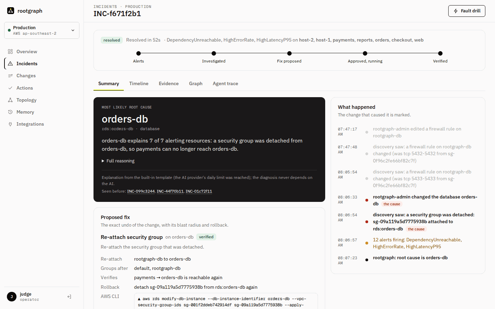
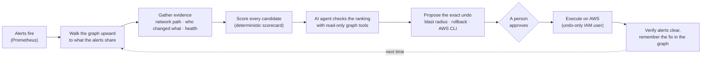
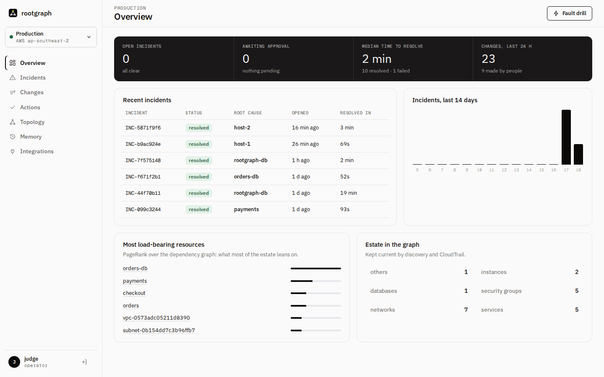
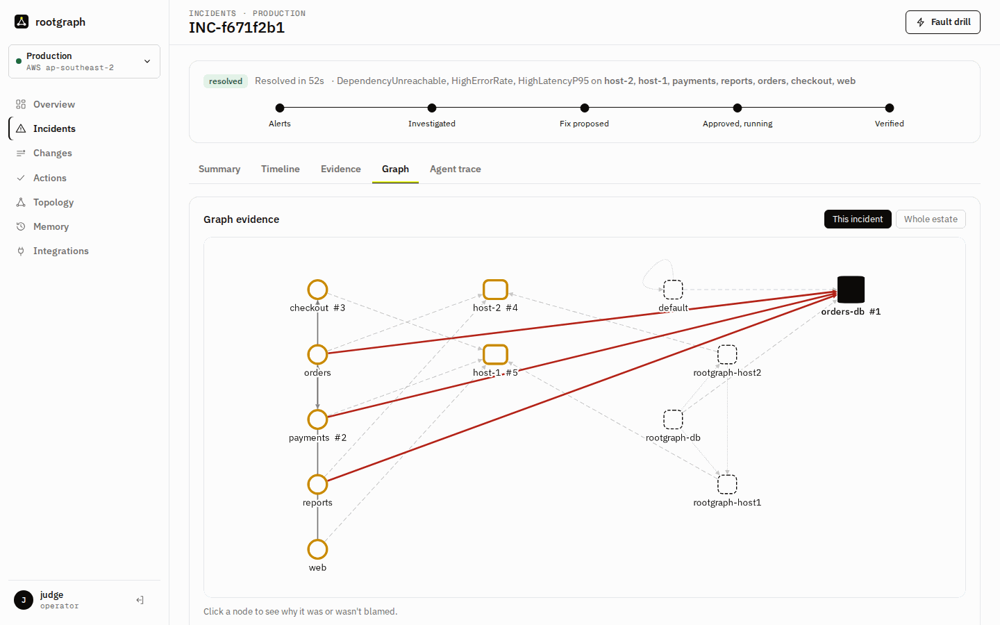
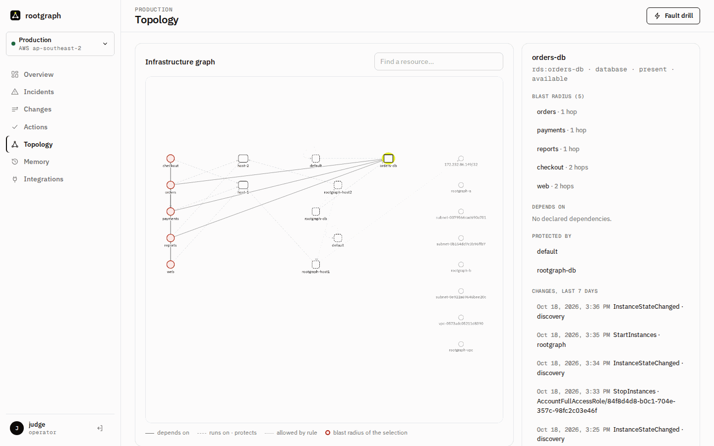
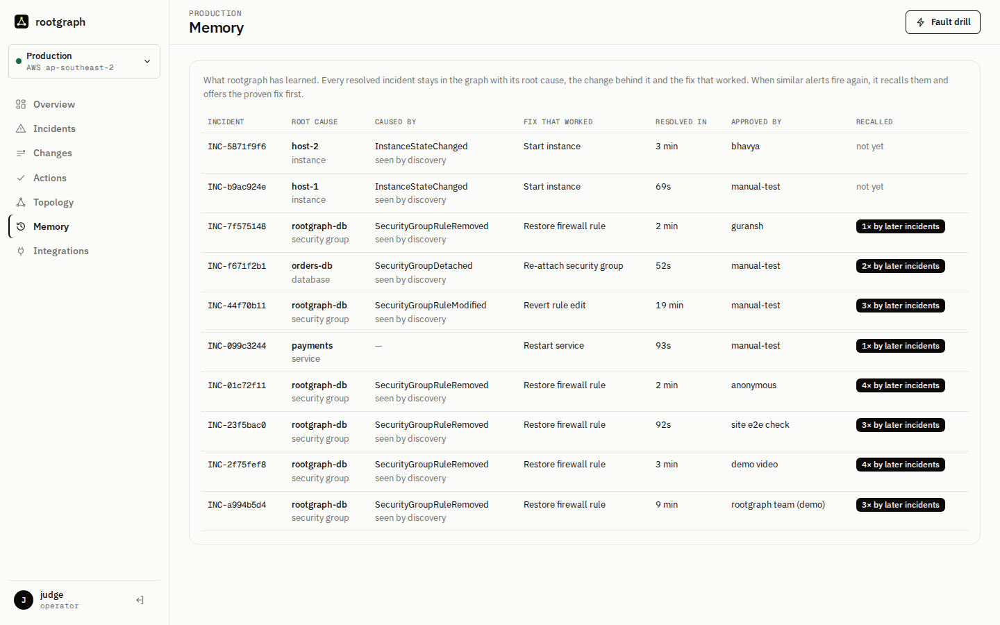
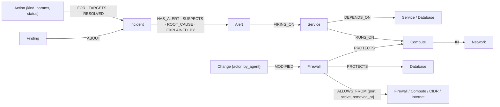
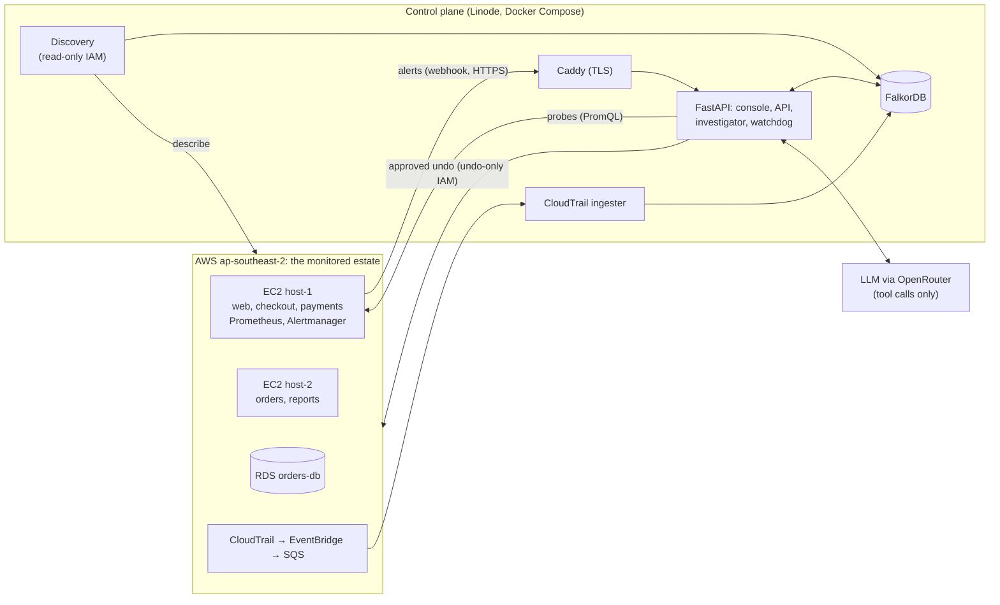

<p align="center">
  
</p>

<h1 align="center">rootgraph</h1>

<p align="center">
  <b>Many alerts, one cause.</b><br>
  An incident responder that finds the change behind an outage by walking a FalkorDB graph of your infrastructure,<br>
  proposes the exact undo, and runs it only after a person approves.
</p>

<p align="center">
  
  
  
  
  
</p>

<p align="center">
  <a href="https://172-232-86-149.sslip.io"><b>Live console</b></a> ·
  <b>Demo video</b> (linked in the submission) ·
  <a href="#run-it-locally"><b>Run it locally</b></a> ·
  <a href="docs/graph.md"><b>Graph model and every Cypher query</b></a>
</p>

<p align="center"></p>

---

## In 30 seconds

Someone changes a firewall rule. Ten alerts fire across five services. Which one is the cause?

rootgraph answers that with a graph. AWS discovery and CloudTrail keep a FalkorDB graph of **services, hosts, databases, security groups, rules, and every change and who made it**. When alerts fire, rootgraph walks the graph **upward** from the alerting resources to what they share. It checks whether the network path is actually open, finds the change that broke it, and ranks every candidate on evidence. An AI agent double-checks the ranking with the same read-only graph tools and explains it in plain words. The result is one root cause and **the exact undo** of the change, which runs only when a signed-in person approves it. When the alerts clear, the incident and its fix are kept in the graph as memory, and the next similar incident starts from the fix that worked.

It runs on a **real AWS account**. Changes made by hand in the AWS console (a rule edited, a security group detached, a server stopped) are found and fixed in **52–153 seconds**.

## For judges: where to find each required item

| The rules ask for | Where it is |
|---|---|
| Public repository | this repo |
| Setup instructions | [Run it locally](#run-it-locally) (Docker, 4 commands) and [demo/aws/setup.md](demo/aws/setup.md) for the AWS estate |
| Graph data model | [Graph data model](#graph-data-model) below, in full in [docs/graph.md](docs/graph.md) |
| Cypher queries and graph algorithms | [Cypher the product depends on](#cypher-the-product-depends-on) below; all 64 query files in [`graph/queries/`](graph/queries), each with its text in [docs/graph.md](docs/graph.md) |
| Demo video | linked in the submission |
| Live deployment | https://172-232-86-149.sslip.io (sign-in required; a judge account is in the submission) |
| Tracks entered | **Track 01: Agents That Act on Connected Data** and **Track 02: Agent Memory and Coordination** ([how each is met](#the-two-tracks)) |
| FalkorDB does real work | [Why the graph is not decoration](#why-the-graph-is-not-decoration) |
| AI use disclosed | [AI assistance](#ai-assistance) |
| Data allowed | the team's own AWS account and a synthetic copy of it; no personal or restricted data |

**Fastest way to see it work (2 minutes):** sign in, switch to **Staging** (top left), click **Simulate incident → Security-group rule revoked → Run drill**. Read the Summary, click **Approve and execute**, then open **Memory**. Step by step, including breaking the real AWS account by hand: [docs/CHECKING.md](docs/CHECKING.md).

## How it works



| Step | What the graph answers | Query |
|---|---|---|
| Walk upward | Which resources do these alerts have in common? | Q2 `correlate_alerts` |
| Check the path | Is `payments → orders-db:5432` allowed by every security group on the way? | Q4 `check_path` |
| Find the culprit | Which rule on that path was removed or edited in the last 30 min, or which security group was detached? | Q10, Q23 |
| Who changed it | What changed in the account, by whom, and when? | Q5, Q24 |
| Remember | Has this cause been fixed before, and with what exact parameters? | Q7 `recall_incidents` |
| Blast radius | What breaks if this resource is down? | Q6 |
| Load-bearing | What does most of the estate lean on? | Q8 PageRank |

A worked example, the headline scenario: a person deletes the rule that lets host-1 reach the database. Coverage alone blames **host-1**, because the most alerts lead there. The graph overturns that: host-1 is healthy, the database answers from host-2, and the path `payments → orders-db` is blocked at the database's security group, which lost a rule 2 minutes earlier (CloudTrail names who removed it). rootgraph ranks the security group first and proposes re-adding that exact rule.

## Proven on a real AWS account

The team broke the real estate (Sydney, `ap-southeast-2`) by hand, and nobody told rootgraph what changed. Times run from incident open to verified fix, with a person approving each fix:

| Change made by hand | rootgraph's conclusion | Undo it proposed | Fixed in |
|---|---|---|---|
| Database security group detached in the RDS console | orders-db lost its security group; 12 alerts across both hosts, one cause | re-attach the group | **52 s** |
| host-2 stopped in the EC2 console | host-2 went running → stopped; its services are victims, not causes | start the instance | 64–153 s |
| host-1 stopped (it runs Prometheus, so nothing can alert) | a watchdog outside the estate files `MonitoringUnreachable`; host-1 was stopped | start the instance | **69 s** |
| A firewall rule revoked | the exact rule that let host-1 reach the database, and who removed it | re-add that rule | 92–140 s |
| `docker stop payments` on host-1 | payments is down; the network is fine | start the container | 93 s |
| A firewall rule edited, port 5432 → 5433 | "rule edited", with the old and new values | edit it back | verified |

The live runs also found 11 bugs that fake-AWS tests could not, each fixed with a regression test. Examples: a webhook blocked behind a slow investigation, verification windows that were too short, IAM gaps, and the monitoring host's public IP changing on restart. They are listed in [DECISIONS.md](DECISIONS.md).

## The console

A sign-in-protected operations console with two environments: **Production** (the real AWS estate) and **Staging** (a simulated copy for fault drills).

| | |
|---|---|
|  **Overview**: open incidents, fixes awaiting approval, time to resolve, the most load-bearing resources (PageRank) |  **Graph evidence**: the broken paths in red, the root cause in ink, alerting services ringed |
|  **Topology**: click any resource for its blast radius, dependencies, security groups and changes |  **Memory**: what rootgraph learned, and how often later incidents recalled it |

Other pages: **Changes** (every change in the account, by person, rootgraph or discovery), **Actions** (the approval audit log), **Agent trace** (every query, with the AI's own calls and its reasons) and **Integrations** (FalkorDB, AWS, CloudTrail, Prometheus, the AI models, and what the executor may and may not do).

## The two tracks

**Track 01: Agents That Act on Connected Data.** The agent acts on the connected data, and only through it:
- **Reads only through the graph.** It chooses among 12 typed, read-only tools, each a fixed Cypher query, and must give a reason for every call. It never writes Cypher.
- **Proposes from a fixed catalogue.** Every fix undoes one kind of change found in the graph: re-add a rule, revert an edit, re-attach a security group, start an instance, start a container.
- **Acts only with approval.** The fix runs on AWS with an undo-only IAM user once a person approves it. Verification then checks that the alerts cleared.

The same 12 tools are exposed over **MCP** (`agent/mcp_server.py`), so Claude Desktop or Claude Code can investigate the same graph.

**Track 02: Agent Memory and Coordination.** Memory lives in the same graph, linked to the infrastructure it is about:
- **Episodic:** `Incident` nodes keep the alerts, the root cause, the change that explained it and the time to resolve.
- **Procedural:** a verified `Action` keeps its kind and exact parameters, so a recalled incident pre-fills the fix ("the same fix resolved INC-… in 52 s").
- **Semantic:** `Finding` nodes hold validated explanations. Every resource they name must resolve in the graph.
- **Coordination:** the pipeline, the AI agent, the human approver and the executor work through one shared record (incident → suspects → proposal → approval → execution → verification). The executor's own changes are tagged `by_agent`, so they are never mistaken for a new cause.

## Why the graph is not decoration

Take FalkorDB out and nothing works:
- **No side store.** Topology, firewall rules, changes, alerts, incidents, actions and memory are all nodes and edges in one graph per environment (`ops_live`, `ops_sandbox`, `ops_test`).
- **The questions are graph questions.** "Which resource do ten alerts share?" is a variable-length upward traversal. "Is payments allowed to reach the database?" joins services, hosts, security groups and rules. "What else breaks?" is a reverse traversal. "What is load-bearing?" is PageRank.
- **Every conclusion traces to a query.** The Agent trace tab shows each call: tool, arguments, outcome, time, the Cypher text and the rows returned.
- **It measurably matters.** On the five headline scenarios, ranking by alert coverage alone is right 2 times out of 5; with the graph evidence (paths, changes, health, memory) rootgraph is right 5 out of 5 ([docs/evaluation.md](docs/evaluation.md), `python -m eval.baseline`).

## Graph data model



- **Infrastructure nodes** carry `Resource` plus a kind label (`Service`, `Compute`, `Database`, `Firewall`, `Network`, `Internet`, `CidrBlock`) and a unique `rid` (`svc:payments`, `i-…`, `rds:orders-db`, `sg-…`).
- **Sources.** Services and their dependencies are declared in `ingest/services.yaml`. Everything else is discovered from AWS every 60 s and resynced before each investigation, and changes stream in from CloudTrail through EventBridge and SQS.
- **History is kept, never deleted.** A removed rule or detached security group becomes `active = false` with `removed_at`; that history is what the undo needs.
- Full model, conventions and indexes: [docs/graph.md](docs/graph.md).

## Cypher the product depends on

All 64 queries are fixed, human-written files in [`graph/queries/`](graph/queries) (33 read, 31 write), bound with parameters, and listed with their full text in [docs/graph.md](docs/graph.md). The core ones:

| Query | Purpose | Technique |
|---|---|---|
| [Q2 `correlate_alerts`](graph/queries/q2_correlate_alerts.cypher) | rank the resources the alerts share | variable-length traversal `[:DEPENDS_ON\|RUNS_ON*0..4]` |
| [Q4 `check_path`](graph/queries/q4_check_path.cypher) | is the dependency allowed by every security group on the way, including the target service's host | multi-hop join over `RUNS_ON`, `PROTECTS`, `ALLOWS_FROM` |
| [Q10 `removed_path_rules`](graph/queries/q10_removed_path_rules.cypher) | which rule on a broken path was removed or edited, and when | same join over inactive rules |
| [Q23 `detached_on_path`](graph/queries/q23_detached_on_path.cypher) | was a security group detached from the host or target | inactive `PROTECTS` edges |
| [Q5 `recent_changes`](graph/queries/q5_recent_changes.cypher) | changes in a resource's 2-hop neighbourhood | `[:RUNS_ON\|PROTECTS\|DEPENDS_ON\|IN*0..2]` |
| [Q6 `blast_radius`](graph/queries/q6_blast_radius.cypher) | what depends on a resource | reverse traversal `*1..4` |
| [Q3 `path_between`](graph/queries/q3_path_between.cypher) | shortest dependency path | `algo.SPpaths` |
| [Q8 `load_bearing`](graph/queries/q8_load_bearing.cypher) | most load-bearing resources | `algo.pageRank` |
| [Q7 `recall_incidents`](graph/queries/q7_recall_incidents.cypher) | past incidents with the same alerts or cause, and the fix that worked | memory recall |
| [W2](graph/queries/w2_diff_removed_rules.cypher) / [W24](graph/queries/w24_diff_detached.cypher) / [W25](graph/queries/w25_state_change.cypher) | graph diff after each discovery sync: removed rules, detached groups, state changes, each recorded as a `Change` | |

## Architecture



**Tech stack:** FalkorDB · Python 3.12 (FastAPI, uv) · Cytoscape.js console · Prometheus, Alertmanager, blackbox and node exporters · AWS (EC2, RDS, CloudTrail, EventBridge, SQS, SSM, IAM) · Caddy · Docker Compose · OpenRouter (free NVIDIA Nemotron models) · MCP.

## Safety

- **Nothing runs without approval.** The pipeline and the AI only propose. A signed-in operator approves, and the approval is recorded under their name.
- **Undo-only permissions.** The executor's IAM user can re-add or edit back rules, re-attach security groups and start instances. It cannot delete or stop anything.
- **No AI-written queries.** The AI picks among fixed, reviewed queries (at most 6 calls, each with a reason). A validator checks its answer, and if the check fails a template explanation is used instead. The diagnosis never depends on the AI.
- **Least privilege everywhere.** Each component has its own IAM user. FalkorDB is bound to localhost. The console needs sign-in (PBKDF2 hashes, signed HttpOnly cookies, rate-limited sign-in). Secrets stay in git-ignored files.
- **Honest when unsure.** Close candidates are shown as "multiple likely causes", with a fix for each. "Not in graph" is shown as such, never as healthy.

## Run it locally

You need Docker and [uv](https://docs.astral.sh/uv/). This brings up FalkorDB, the API and the console:

```bash
git clone https://github.com/guranshdeol/rootgraph-incident-responder rootgraph && cd rootgraph
```

```bash
cp .env.example .env
```

Fill in `FALKORDB_PASSWORD`, `WEBHOOK_TOKEN` and `ADMIN_TOKEN` in `.env` (`openssl rand -hex 32` for each), and set `PUBLIC_HOST=localhost`. Then:

```bash
docker compose up -d --build
```

```bash
uv run python -m api.auth add admin operator
```

That creates your first user (the password is saved in `demo/accounts.txt`) and a session secret in `.env`. Load them with `docker compose up -d api`, open https://localhost, sign in, switch to **Staging** and run a drill. Staging loads its simulated estate on first start and needs no cloud account.

**Tests** (88: every query through the tools, all nine scenarios, the AWS code against moto, the agent loop, the API, MCP and the evaluation claim):

```bash
uv sync && set -a && . ./.env && set +a && FALKORDB_HOST=localhost PROMETHEUS_URL= LLM_API_KEY= uv run pytest -q
```

**Optional:**
- **Real AWS:** follow [demo/aws/setup.md](demo/aws/setup.md) (`demo/aws/estate.py up` creates the estate, CloudTrail stream and least-privilege IAM users), then `docker compose --profile aws up -d`.
- **AI agent:** set `LLM_API_KEY` and `LLM_MODEL` (an OpenRouter model id with tool calling; a comma-separated list is used as fallbacks).
- **MCP:**

  ```bash
  FALKORDB_HOST=localhost MCP_GRAPH=ops_sandbox uv run python -m agent.mcp_server
  ```

## Limitations

- **The scoring weights are heuristic,** tuned on the nine fixture scenarios.
- **With two causes at once,** both are ranked and each gets a fix, but the alerts are not split between them.
- **Dependencies are declared** in `services.yaml`, not learned from traffic.
- **Discovery models IPv4 ingress rules only;** IPv6 and prefix lists are skipped. CIDR containment is not matched; only exact sources are.
- **The graph view shows the current graph,** not a snapshot from the time of the incident.
- **Accounts are per person, without SSO.** A production version would use the company identity provider.

## AI assistance

This project was built with AI coding assistants, as the rules allow, and we disclose it here. **Claude Code** (Anthropic's Claude Opus and Claude Haiku models) was used throughout to write code, tests and documentation.

The team chose the problem, the scope, the graph model and every design decision, and reviewed the queries and the code. They ran the system against the fixtures and against their own AWS account, breaking it by hand in ways the tests had not anticipated and feeding the failures back as fixes. [`plan.md`](plan.md) holds the plan, and [`DECISIONS.md`](DECISIONS.md) records the reason for each non-obvious choice and every bug found live.

All work was done during the hackathon: the first commit is from 17 Oct 2026, 00:12 IST.

## Repository layout

```
agent/      investigation pipeline, typed graph tools, scoring, validator, LLM agent, actions, memory, MCP server
api/        FastAPI app: console, sign-in, API, webhook, watchdog
graph/      FalkorDB client, 64 Cypher query files, estate and scenario fixtures
ingest/     AWS discovery and graph diff, CloudTrail stream, alert ingestion, services.yaml
demo/       demo services, Prometheus and Alertmanager config, AWS estate script, fault scripts
docs/       graph.md (model and every query), CHECKING.md (how to try it), DESIGN.md, evaluation.md
tests/      88 pytest tests against a FalkorDB test graph
eval/       baseline rankers for the evaluation
```
