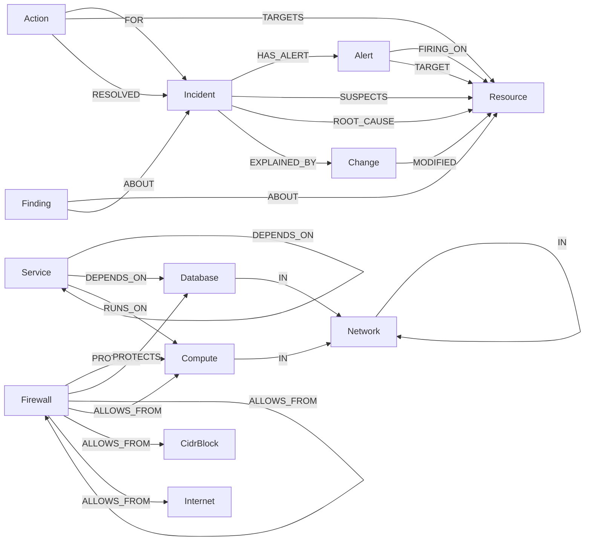

# Graph data model

rootgraph keeps the AWS estate, the alerts, the infrastructure changes, incidents and agent memory in one property graph, stored in FalkorDB. The graph is a FalkorDB multigraph with these graphs:

- `ops_live`: the real AWS estate, kept current by discovery and the CloudTrail stream.
- `ops_sandbox`: fixture and replayed scenarios, used by the public demo.
- `ops_test`: fixtures for pytest.
- `ops_synthetic`: a labelled synthetic estate. This is a stretch goal and is not built.

Every conclusion the agent reaches comes from a Cypher query. The queries in the [Cypher catalogue](#cypher-catalogue) are the only ones the product runs against the graph; the LLM does not write Cypher.

## Conventions

- Every infrastructure node has the label `:Resource` plus a kind label (`Service`, `Compute`, `Database`, `Firewall`, `Network`, `Internet`, `CidrBlock`) and a unique `rid`.
- `rid` formats:
  - `svc:<name>` for services
  - `i-…` for EC2 instance ids
  - `rds:<db-identifier>` for RDS databases
  - `sg-…` for security groups
  - `vpc-…` and `subnet-…` for networks
  - `internet` for the internet node
  - `cidr:<block>` for CIDR blocks
- Every node and edge from discovery carries `source` and `last_seen` (epoch seconds). `source` is `aws_api | declared | observed | agent`. `Change` nodes use `source` = `cloudtrail | graph_diff`.
- Timestamps are epoch seconds (int) everywhere.
- Every `DEPENDS_ON` and `RUNS_ON` edge has `weight` (default 1), so `algo.SPpaths` works.

## Nodes

| Label(s) | Key properties | Source |
|---|---|---|
| `Resource:Service` | rid, name, port | `services.yaml` |
| `Resource:Compute` | rid, name, private_ip, public_ip, state, instance_type | EC2 describe |
| `Resource:Database` | rid, name, engine, endpoint, port, status | RDS describe |
| `Resource:Firewall` | rid, name, kind=`security_group` | EC2 describe |
| `Resource:Network` | rid, kind (`vpc`/`subnet`), cidr | EC2 describe |
| `Resource:Internet` / `Resource:CidrBlock` | rid, cidr | Derived from SG rules |
| `Alert` | id (=fingerprint + ":" + starts_at), fingerprint, alertname, severity, status, starts_at, ends_at | Alertmanager |
| `Change` | event_id, source (`cloudtrail`/`graph_diff`), event_name, actor, at, by_agent, request (trimmed JSON) | Stream / diff |
| `Incident` | id, group_key, opened_at, closed_at, status, summary, ttr_seconds | Agent |
| `Action` | id, kind, params (JSON), status (`proposed/approved/rejected/executed/verified/failed`), proposed_at, approved_by, executed_at | Agent |
| `Finding` | id, text, at, confidence | Agent (validated text) |

The Alert `id` includes `starts_at` on purpose. Alertmanager fingerprints are stable per label set, so a repeat of the same alert would otherwise reuse the old node.

## Edges

```
(:Service)-[:DEPENDS_ON {kind: http|db, port, source: declared|observed, weight, last_seen}]->(:Service|:Database)
(:Service)-[:RUNS_ON {weight}]->(:Compute)
(:Compute|:Database)-[:IN]->(:Network {kind:'subnet'})-[:IN]->(:Network {kind:'vpc'})
(:Firewall)-[:PROTECTS]->(:Compute|:Database)
(:Firewall)-[:ALLOWS_FROM {rule_id, proto, port_from, port_to, active, last_seen, removed_at}]->(:Firewall|:Compute|:CidrBlock|:Internet)
(:Alert)-[:FIRING_ON]->(:Resource)
(:Alert)-[:TARGET]->(:Resource)                 // blackbox probes: what the probe was trying to reach
(:Change)-[:MODIFIED]->(:Resource)
(:Incident)-[:HAS_ALERT]->(:Alert)
(:Incident)-[:SUSPECTS {score, rank}]->(:Resource)
(:Incident)-[:ROOT_CAUSE]->(:Resource)
(:Incident)-[:EXPLAINED_BY]->(:Change)
(:Action)-[:FOR]->(:Incident)
(:Action)-[:TARGETS]->(:Resource)
(:Action)-[:RESOLVED]->(:Incident)
(:Finding)-[:ABOUT]->(:Resource|:Incident)
```

## Diagram

Node labels and relationship types. `Resource` is the shared base label; it stands for any infrastructure node in the edges that point at it.



## Security-group modelling rules

- `ALLOWS_FROM` points from the protecting SG to the **source** of allowed traffic.
- SG-to-SG references become an edge to that `Firewall`.
- A `/32` matching a known host becomes an edge to that `Compute`.
- `0.0.0.0/0` becomes an edge to `Internet`.
- Any other CIDR becomes an edge to a `CidrBlock`.
- Ingress rules only for v1.
- Removed rules are **never deleted**. They get `active=false` and `removed_at`. That history is what lets us restore the exact rule.

## Indexes

Defined in `graph/schema.cypher` and applied once per graph:

```cypher
CREATE INDEX FOR (r:Resource) ON (r.rid);
CREATE INDEX FOR (a:Alert) ON (a.id);
CREATE INDEX FOR (c:Change) ON (c.event_id);
CREATE INDEX FOR (i:Incident) ON (i.id);
CREATE INDEX FOR (x:Action) ON (x.id);
```

# Cypher catalogue

Every query file in `graph/queries/`, copied verbatim. The leading `//` comment lines are removed; nothing else is changed. Files are listed in name order (`q1`…`q21`, then `w1`, `w1b`, `w2`…`w23`). The `$name` placeholders are parameters bound by the caller.

## Read queries (agent tools)

### q1_resolve

Checks that a rid or name exists and returns its canonical rid and labels; backs the `resolve` tool, and every rid argument is resolved through it first.

Params: $x

```cypher
MATCH (r:Resource) WHERE r.rid = $x OR r.name = $x
RETURN r.rid AS rid, labels(r) AS kinds LIMIT 1
```

### q2_correlate_alerts

Walks upward from alerting resources to the candidates that explain them, ranked by coverage; backs the `correlate_alerts` tool (investigation step 3).

Params: $alert_rids, $k

```cypher
UNWIND $alert_rids AS rid
MATCH p = (s:Resource {rid: rid})-[:DEPENDS_ON|RUNS_ON*0..4]->(c:Resource)
WITH c, rid, min(length(p)) AS hops
WITH c, collect(rid) AS explains, min(hops) AS min_hops
RETURN c.rid AS candidate, labels(c) AS kinds, size(explains) AS coverage, explains, min_hops
ORDER BY coverage DESC, min_hops ASC
LIMIT $k
```

### q3_path_between

Returns the shortest dependency path between two resources using `algo.SPpaths`; backs the `path_between` tool.

Params: $from, $to

```cypher
MATCH (a:Resource {rid: $from}), (b:Resource {rid: $to})
CALL algo.SPpaths({sourceNode: a, targetNode: b, relTypes: ['DEPENDS_ON','RUNS_ON'],
                   relDirection: 'outgoing', weightProp: 'weight', pathCount: 1})
YIELD path, pathWeight
RETURN [n IN nodes(path) | n.rid] AS hops, pathWeight
```

### q4_check_path

Decides whether the network route for a service-to-resource dependency is permitted, aggregated across all firewalls on the target; backs the `check_path` tool and the path sweep (investigation step 4).

Params: $from, $to

```cypher
MATCH (x:Service {rid: $from})-[:RUNS_ON]->(h:Compute)
MATCH (x)-[d:DEPENDS_ON]->(y:Resource {rid: $to})
MATCH (fw:Firewall)-[:PROTECTS]->(y)
OPTIONAL MATCH (hfw:Firewall)-[:PROTECTS]->(h)
WITH h, d, collect(DISTINCT fw) AS target_fws, collect(DISTINCT hfw) AS host_fws
UNWIND target_fws AS fw
OPTIONAL MATCH (fw)-[r:ALLOWS_FROM]->(src)
  WHERE r.active = true
    AND r.port_from <= d.port AND d.port <= r.port_to
    AND (src = h OR src:Internet OR src IN host_fws)
WITH h, d, fw, collect(r.rule_id) AS rules
RETURN h.rid AS host, d.port AS port,
       collect({firewall: fw.rid, rules: rules}) AS per_firewall,
       sum(size(rules)) > 0 AS permitted
```

### q5_recent_changes

Lists the most recent `Change` nodes on a resource and its 2-hop infrastructure neighbourhood; backs the `recent_changes` tool and the evidence step.

Params: $rid, $since

```cypher
MATCH (r:Resource {rid: $rid})-[:RUNS_ON|PROTECTS|DEPENDS_ON|IN*0..2]-(n:Resource)
WITH DISTINCT n
MATCH (ch:Change)-[:MODIFIED]->(n)
WHERE ch.at >= $since
RETURN ch.event_id, ch.source, ch.event_name, ch.actor, ch.at, ch.by_agent, n.rid AS on_resource
ORDER BY ch.at DESC LIMIT 10
```

### q6_blast_radius

Lists everything upstream that depends on a resource, up to a depth; backs the `blast_radius` tool and the blast radius shown for a proposed action.

Params: $rid, $depth

```cypher
MATCH p = (up:Resource)-[:DEPENDS_ON|RUNS_ON*1..4]->(t:Resource {rid: $rid})
WHERE length(p) <= $depth
WITH up, min(length(p)) AS hops, collect([n IN nodes(p) | n.rid])[0] AS via
RETURN up.rid AS affected, hops, via
ORDER BY hops, affected
```

### q7_recall_incidents

Finds past resolved incidents that match the alert names or candidate root causes of the current one; backs the `recall_incidents` tool (memory recall, step 2).

Params: $alertnames, $candidate_rids

```cypher
MATCH (i:Incident {status: 'resolved'})-[:ROOT_CAUSE]->(rc:Resource)
OPTIONAL MATCH (i)-[:HAS_ALERT]->(al:Alert)
WITH i, rc, collect(DISTINCT al.alertname) AS past_alerts
WITH i, rc, size([a IN past_alerts WHERE a IN $alertnames]) AS alert_overlap,
     CASE WHEN rc.rid IN $candidate_rids THEN 1 ELSE 0 END AS same_cause
WHERE alert_overlap > 0 OR same_cause = 1
OPTIONAL MATCH (i)-[:EXPLAINED_BY]->(ch:Change)
OPTIONAL MATCH (act:Action {status: 'verified'})-[:RESOLVED]->(i)
RETURN i.id, i.opened_at, i.ttr_seconds, rc.rid AS root_cause, ch.event_name AS change,
       act.kind AS fix, act.params AS fix_params, alert_overlap, same_cause
ORDER BY same_cause DESC, alert_overlap DESC, i.opened_at DESC
LIMIT 3
```

### q8_load_bearing

Ranks resources by PageRank over `DEPENDS_ON`; backs the `load_bearing` tool and the Graph tab ranking.

Params: $limit

```cypher
CALL algo.pageRank('Resource', 'DEPENDS_ON') YIELD node, score
RETURN node.rid AS resource, score ORDER BY score DESC LIMIT $limit
```

### q9_dependencies

Lists what a service calls (its outgoing `DEPENDS_ON` targets with port and kind); drives the `check_path` sweep in the investigation pipeline.

Params: $rid

```cypher
MATCH (s:Resource {rid: $rid})-[d:DEPENDS_ON]->(t:Resource)
RETURN t.rid AS target, d.kind AS kind, d.port AS port
ORDER BY target
```

### q10_removed_path_rules

On a broken path, lists inactive firewall rules removed since a given time that matched the dependency port and source, using the same matching as Q4; called by the `removed_rules` tool, which the investigation uses to pick the culprit firewall.

Params: $from, $to, $since

```cypher
MATCH (x:Service {rid: $from})-[:RUNS_ON]->(h:Compute)
MATCH (x)-[d:DEPENDS_ON]->(y:Resource {rid: $to})
MATCH (fw:Firewall)-[:PROTECTS]->(y)
OPTIONAL MATCH (hfw:Firewall)-[:PROTECTS]->(h)
WITH h, d, fw, collect(DISTINCT hfw) AS host_fws
MATCH (fw)-[r:ALLOWS_FROM]->(src)
WHERE r.active = false AND r.removed_at >= $since
  AND r.port_from <= d.port AND d.port <= r.port_to
  AND (src = h OR src:Internet OR src IN host_fws)
RETURN fw.rid AS firewall, r.rule_id AS rule_id, coalesce(r.original_rule_id, r.rule_id) AS original_rule_id,
       r.proto AS proto, r.port_from AS port_from, r.port_to AS port_to, src.rid AS source, r.removed_at AS removed_at
ORDER BY removed_at DESC
```

### q11_removed_rules_on_firewall

Lists the inactive rules removed from one firewall since a given time; it gives the precondition and exact spec for `restore_firewall_rule` (plan §7.6).

Params: $fw, $since

```cypher
MATCH (fw:Firewall {rid: $fw})-[r:ALLOWS_FROM]->(src)
WHERE r.active = false AND r.removed_at >= $since
RETURN r.rule_id AS rule_id, coalesce(r.original_rule_id, r.rule_id) AS original_rule_id,
       r.proto AS proto, r.port_from AS port_from, r.port_to AS port_to, src.rid AS source, r.removed_at AS removed_at
ORDER BY removed_at DESC
```

### q12_open_incident_for_group

Finds the open incident for an Alertmanager group that was opened since a given time, so new alerts attach to it (plan §6.5).

Params: $group_key, $since

```cypher
MATCH (i:Incident {group_key: $group_key, status: 'open'})
WHERE i.opened_at >= $since
RETURN i.id AS id, i.opened_at AS opened_at
ORDER BY opened_at DESC LIMIT 1
```

### q13_incident_alerts

Lists the alerts of one incident with the resource each one fires on and the resource it targets; used by `agent/investigate.py` (step 1) and by action verification.

Params: $id

```cypher
MATCH (i:Incident {id: $id})-[:HAS_ALERT]->(a:Alert)
OPTIONAL MATCH (a)-[:FIRING_ON]->(r:Resource)
OPTIONAL MATCH (a)-[:TARGET]->(t:Resource)
RETURN a.id AS id, a.alertname AS alertname, a.status AS status, a.starts_at AS starts_at,
       r.rid AS rid, t.rid AS target_rid
ORDER BY starts_at, id
```

### q14_get_action

Returns one action with its incident and target resource; used by `agent/actions.py` (execute, verify).

Params: $id

```cypher
MATCH (x:Action {id: $id})-[:FOR]->(i:Incident)
OPTIONAL MATCH (x)-[:TARGETS]->(t:Resource)
RETURN x.id AS id, x.kind AS kind, x.params AS params, x.status AS status,
       x.proposed_at AS proposed_at, x.approved_by AS approved_by, i.id AS incident_id, t.rid AS target_rid
```

### q15_active_rules_on_firewall

Lists the current active rules of one firewall; the sandbox fault injection replays a discovery sync with it (per the file comment).

Params: $fw

```cypher
MATCH (fw:Firewall {rid: $fw})-[r:ALLOWS_FROM]->(src)
WHERE r.active = true
RETURN r.rule_id AS rule_id, r.proto AS proto, r.port_from AS port_from, r.port_to AS port_to, src.rid AS source
ORDER BY rule_id
```

### q16_service_host

Returns the host a service runs on; `restart_service` needs it to target SSM Run Command (`agent/actions.py`).

Params: $rid

```cypher
MATCH (s:Service {rid: $rid})-[:RUNS_ON]->(h:Compute)
RETURN h.rid AS host, h.name AS host_name
```

### q17_resource_nodes

Every infrastructure node, for the UI graph panel (`GET /api/graph`).

Params: none

```cypher
MATCH (n:Resource)
RETURN n.rid AS rid, labels(n) AS kinds, n.name AS name
ORDER BY rid
```

### q18_resource_edges

Infrastructure edges between resources, with ALLOWS_FROM active/port so removed rules can be drawn (`GET /api/graph`).

Params: none

```cypher
MATCH (a:Resource)-[r:DEPENDS_ON|RUNS_ON|PROTECTS|ALLOWS_FROM]->(b:Resource)
RETURN a.rid AS source, type(r) AS type, b.rid AS target, r.active AS active,
       r.port_from AS port_from, r.port_to AS port_to, r.rule_id AS rule_id
```

### q19_list_incidents

Newest incidents with their rank-1 suspect (`GET /api/incidents`).

Params: $limit

```cypher
MATCH (i:Incident)
OPTIONAL MATCH (i)-[s:SUSPECTS]->(r:Resource)
WHERE s.rank = 1
RETURN i.id AS id, i.status AS status, i.opened_at AS opened_at, i.closed_at AS closed_at,
       i.ttr_seconds AS ttr_seconds, r.rid AS top
ORDER BY opened_at DESC
LIMIT $limit
```

### q20_get_incident

One incident's stored report, status and actions (`GET /api/incidents/{id}`).

Params: $id

```cypher
MATCH (i:Incident {id: $id})
OPTIONAL MATCH (x:Action)-[:FOR]->(i)
RETURN i.id AS id, i.status AS status, i.opened_at AS opened_at, i.ttr_seconds AS ttr_seconds,
       i.report AS report,
       collect(CASE WHEN x IS NULL THEN null ELSE {id: x.id, kind: x.kind, status: x.status, approved_by: x.approved_by, detail: x.detail} END) AS actions
```

### q21_open_action_for

open_action_for: an action already proposed (or approved, executed, verified) for this incident, kind and target, so a re-investigation reuses it instead of proposing twice, even if it finished after the approval.

Params: $incident_id, $kind, $target_rid

```cypher
MATCH (x:Action {kind: $kind})-[:FOR]->(:Incident {id: $incident_id})
WHERE x.status IN ['proposed', 'approved', 'executed', 'verified']
MATCH (x)-[:TARGETS]->(:Resource {rid: $target_rid})
RETURN x.id AS id, x.status AS status
ORDER BY x.proposed_at DESC
LIMIT 1
```

### q22_incident_of_alerts

incident_of_alerts: which incident already holds these alerts (any status), so a later notification for the same alerts never opens a second incident.

Params: $ids

```cypher
MATCH (i:Incident)-[:HAS_ALERT]->(a:Alert)
WHERE a.id IN $ids
RETURN i.id AS id, i.status AS status, collect(a.id) AS alert_ids
ORDER BY size(alert_ids) DESC
```

### q23_detached_on_path

detached_on_path: on a broken path, was a security group detached since $since from the dependency's host or from its target? (The other way a path breaks besides a removed rule.)

Params: $from, $to, $since

```cypher
MATCH (x:Service {rid: $from})-[:RUNS_ON]->(h:Compute)
MATCH (x)-[:DEPENDS_ON]->(y:Resource {rid: $to})
MATCH (fw:Firewall)-[p:PROTECTS]->(n:Resource)
WHERE (n = h OR n = y) AND p.active = false AND p.removed_at >= $since
RETURN fw.rid AS firewall, n.rid AS target, labels(n) AS target_kinds, p.removed_at AS removed_at
ORDER BY removed_at DESC
```

### q24_changes_since

changes_since: every change anywhere in the estate since $since, newest first: the "what changed in the account" feed, and the agent's tool to search for a change it hasn't been shown.

Params: $since, $limit

```cypher
MATCH (ch:Change)
WHERE ch.at >= $since
OPTIONAL MATCH (ch)-[:MODIFIED]->(r:Resource)
WITH ch, collect(r.rid) AS resources, collect(coalesce(r.name, r.rid)) AS names
RETURN ch.event_id AS event_id, ch.at AS at, ch.source AS source, ch.event_name AS event_name, ch.actor AS actor,
       ch.by_agent AS by_agent, ch.before AS before, ch.after AS after, resources, names
ORDER BY at DESC
LIMIT $limit
```

### q25_active_firewalls_of

active_firewalls_of: the security groups currently attached to an instance or database (reattach_security_group sends the full list back to AWS).

Params: $rid

```cypher
MATCH (fw:Firewall)-[p:PROTECTS]->(:Resource {rid: $rid})
WHERE coalesce(p.active, true)
RETURN fw.rid AS firewall
ORDER BY firewall
```

### q26_resource_state

resource_state: an instance's or database's last discovered state.

Params: $rid

```cypher
MATCH (r:Resource {rid: $rid})
RETURN r.rid AS rid, labels(r) AS kinds, r.state AS state, r.status AS status, r.name AS name
```

### q27_detached_from

detached_from: security groups detached from this resource since $since (precondition for reattach_security_group).

Params: $rid, $since

```cypher
MATCH (fw:Firewall)-[p:PROTECTS]->(:Resource {rid: $rid})
WHERE p.active = false AND p.removed_at >= $since
RETURN fw.rid AS firewall, p.removed_at AS removed_at
ORDER BY removed_at DESC
```

## Write queries (ingestion, investigation, memory)

### w1_upsert_rule

Upserts one security-group rule as an `ALLOWS_FROM` edge during AWS discovery (plan §6.1).

Params: $fw, $src_rid, $rule_id, $proto, $from_port, $to_port, $sync_ts

```cypher
MATCH (fw:Firewall {rid: $fw}), (src:Resource {rid: $src_rid})
MERGE (fw)-[r:ALLOWS_FROM {rule_id: $rule_id}]->(src)
SET r.proto = $proto, r.port_from = $from_port, r.port_to = $to_port,
    r.active = true, r.last_seen = $sync_ts, r.removed_at = null
```

### w1b_detect_modified_rule

Retires the old edge of a rule whose proto, ports or source changed, under a suffixed `rule_id`, and writes a `SecurityGroupRuleModified` `Change`; discovery runs it before W1 for each rule (plan §6.2).

Params: Same as W1: $fw, $src_rid, $rule_id, $proto, $from_port, $to_port, $sync_ts

```cypher
MATCH (fw:Firewall {rid: $fw})-[r:ALLOWS_FROM {rule_id: $rule_id}]->(src)
WHERE r.active = true
  AND (r.proto <> $proto OR r.port_from <> $from_port OR r.port_to <> $to_port OR src.rid <> $src_rid)
SET r.active = false, r.removed_at = $sync_ts,
    r.rule_id = $rule_id + '@' + toString($sync_ts), r.original_rule_id = $rule_id
CREATE (ch:Change {event_id: 'diff:mod:' + $rule_id + ':' + toString($sync_ts), source: 'graph_diff',
                   event_name: 'SecurityGroupRuleModified', at: $sync_ts, rule_id: $rule_id,
                   before: r.proto + ' ' + toString(r.port_from) + '-' + toString(r.port_to) + ' from ' + src.rid,
                   after: $proto + ' ' + toString($from_port) + '-' + toString($to_port) + ' from ' + $src_rid})
CREATE (ch)-[:MODIFIED]->(fw)
RETURN r.rule_id
```

### w2_diff_removed_rules

Marks rules not seen in this sync as removed and writes a `SecurityGroupRuleRemoved` `Change` (graph diff, plan §6.2); discovery runs it after syncing each firewall.

Params: $fw, $sync_ts

```cypher
MATCH (fw:Firewall {rid: $fw})-[r:ALLOWS_FROM]->(src)
WHERE r.active = true AND r.last_seen < $sync_ts
SET r.active = false, r.removed_at = $sync_ts
CREATE (ch:Change {event_id: 'diff:' + r.rule_id + ':' + toString($sync_ts), source: 'graph_diff',
                   event_name: 'SecurityGroupRuleRemoved', at: $sync_ts, rule_id: r.rule_id})
CREATE (ch)-[:MODIFIED]->(fw)
RETURN r.rule_id, src.rid
```

### w3_ingest_change

MERGEs a CloudTrail `Change` and links it to the resources it touched; called by the CloudTrail ingester (plan §6.3).

Params: $event_id, $event_name, $actor, $at, $by_agent, $request_json, $rids

```cypher
MERGE (ch:Change {event_id: $event_id})
ON CREATE SET ch.source = 'cloudtrail', ch.event_name = $event_name, ch.actor = $actor,
              ch.at = $at, ch.by_agent = $by_agent, ch.request = $request_json
WITH ch
UNWIND $rids AS rid
MATCH (r:Resource {rid: rid})
MERGE (ch)-[:MODIFIED]->(r)
```

### w4_ingest_alert

MERGEs an `Alert` and links it to the resource it fires on; called by the alert ingester for each Alertmanager webhook alert (plan §6.5).

Params: $id, $fp, $alertname, $status, $severity, $starts_at, $ends_at, $rid

```cypher
MERGE (a:Alert {id: $id})
SET a.fingerprint = $fp, a.alertname = $alertname, a.status = $status,
    a.severity = $severity, a.starts_at = $starts_at, a.ends_at = $ends_at
WITH a
MATCH (r:Resource {rid: $rid})
MERGE (a)-[:FIRING_ON]->(r)
```

### w4b_alert_target

Links an alert to the resource its blackbox probe was trying to reach; called by the alert ingester (plan §6.5).

Params: $id, $target_rid

```cypher
MATCH (a:Alert {id: $id}), (t:Resource {rid: $target_rid})
MERGE (a)-[:TARGET]->(t)
```

### w5_open_incident

Creates an open `Incident` for an Alertmanager group and links its alerts (plan §6.5).

Params: $id, $group_key, $now, $alert_ids

```cypher
CREATE (i:Incident {id: $id, group_key: $group_key, opened_at: $now, status: 'open'})
WITH i
UNWIND $alert_ids AS aid
MATCH (a:Alert {id: aid})
MERGE (i)-[:HAS_ALERT]->(a)
```

### w5b_attach_alerts

Attaches alerts to an already-open incident, per the grouping rule in plan §6.5.

Params: $id, $alert_ids

```cypher
MATCH (i:Incident {id: $id})
UNWIND $alert_ids AS aid
MATCH (a:Alert {id: aid})
MERGE (i)-[:HAS_ALERT]->(a)
```

### w6_close_incident

Closes an incident and stores its memory: time to resolve, root cause, the verified action and the explaining `Change`; called when an action is verified (plan §7.3 step 11).

Params: $id, $root_rid, $action_id, $now, $summary, $change_id

```cypher
MATCH (i:Incident {id: $id}), (rc:Resource {rid: $root_rid}), (act:Action {id: $action_id})
SET i.status = 'resolved', i.closed_at = $now, i.ttr_seconds = $now - i.opened_at, i.summary = $summary
MERGE (i)-[:ROOT_CAUSE]->(rc)
MERGE (act)-[:RESOLVED]->(i)
WITH i
OPTIONAL MATCH (ch:Change {event_id: $change_id})
FOREACH (_ IN CASE WHEN ch IS NULL THEN [] ELSE [1] END | MERGE (i)-[:EXPLAINED_BY]->(ch))
```

### w7_write_suspects

Writes the scorecard as `SUSPECTS` edges with score and rank; called by the investigation pipeline (plan §7.3 step 6).

Params: $id, $rows = [{rid, score, rank}]

```cypher
MATCH (i:Incident {id: $id})
UNWIND $rows AS row
MATCH (r:Resource {rid: row.rid})
MERGE (i)-[s:SUSPECTS]->(r)
SET s.score = row.score, s.rank = row.rank
```

### w8_create_action

Creates a `proposed` `Action` linked to its incident and target; backs `propose_action` (plan §7.1).

Params: $id, $kind, $params (JSON), $now, $incident_id, $target_rid

```cypher
MATCH (i:Incident {id: $incident_id}), (t:Resource {rid: $target_rid})
CREATE (x:Action {id: $id, kind: $kind, params: $params, status: 'proposed', proposed_at: $now})
CREATE (x)-[:FOR]->(i)
CREATE (x)-[:TARGETS]->(t)
RETURN x.id AS id
```

### w9_transition_action

Moves an `Action` along its state machine, only from an allowed state; called on approve or reject, execute, and verify or fail (plan §7.6).

Params: $id, $from (list), $to, $now, $actor, $detail

```cypher
MATCH (x:Action {id: $id})
WHERE x.status IN $from
SET x.status = $to, x.updated_at = $now, x.detail = $detail,
    x.approved_by = CASE WHEN $to = 'approved' THEN $actor ELSE x.approved_by END,
    x.executed_at = CASE WHEN $to = 'executed' THEN $now ELSE x.executed_at END
RETURN x.id AS id, x.status AS status
```

### w10_record_finding

Records a validated `Finding` about an incident and its resources; backs `record_finding` (plan §7.1).

Params: $id, $text, $now, $confidence, $incident_id, $about_rids

```cypher
MATCH (i:Incident {id: $incident_id})
CREATE (f:Finding {id: $id, text: $text, at: $now, confidence: $confidence})
CREATE (f)-[:ABOUT]->(i)
WITH f
UNWIND $about_rids AS rid
MATCH (r:Resource {rid: rid})
CREATE (f)-[:ABOUT]->(r)
```

### w11_update_incident

Stores the investigation report JSON and, optionally, a new incident status; used by `agent/investigate.py` and `agent/memory.py`.

Params: $id, $report, $status

```cypher
MATCH (i:Incident {id: $id})
SET i.report = coalesce($report, i.report), i.status = coalesce($status, i.status)
RETURN i.id AS id, i.status AS status
```

### w12_upsert_network

Upsert a VPC or subnet; a subnet is linked IN its VPC.

Params: $rid, $name, $kind, $cidr, $parent_rid (null for a VPC), $sync_ts

```cypher
MERGE (n:Resource:Network {rid: $rid})
SET n.name = $name, n.kind = $kind, n.cidr = $cidr, n.source = 'aws_api', n.last_seen = $sync_ts, n.state = 'present'
WITH n
OPTIONAL MATCH (p:Network {rid: $parent_rid})
FOREACH (_ IN CASE WHEN p IS NULL THEN [] ELSE [1] END |
  MERGE (n)-[e:IN]->(p) SET e.source = 'aws_api', e.last_seen = $sync_ts)
```

### w13_upsert_compute

Upsert an EC2 instance, IN its subnet.

Params: $rid, $name, $private_ip, $public_ip, $state, $instance_type, $subnet_rid, $sync_ts

```cypher
MERGE (c:Resource:Compute {rid: $rid})
SET c.name = $name, c.private_ip = $private_ip, c.public_ip = $public_ip, c.state = $state,
    c.instance_type = $instance_type, c.source = 'aws_api', c.last_seen = $sync_ts
WITH c
OPTIONAL MATCH (s:Network {rid: $subnet_rid})
FOREACH (_ IN CASE WHEN s IS NULL THEN [] ELSE [1] END |
  MERGE (c)-[e:IN]->(s) SET e.source = 'aws_api', e.last_seen = $sync_ts)
```

### w14_upsert_database

Upsert an RDS instance, IN each subnet of its subnet group.

Params: $rid, $name, $engine, $endpoint, $port, $status, $subnet_rids, $sync_ts

```cypher
MERGE (d:Resource:Database {rid: $rid})
SET d.name = $name, d.engine = $engine, d.endpoint = $endpoint, d.port = $port, d.status = $status,
    d.source = 'aws_api', d.last_seen = $sync_ts, d.state = 'present'
WITH d
UNWIND (CASE WHEN size($subnet_rids) = 0 THEN [null] ELSE $subnet_rids END) AS srid
OPTIONAL MATCH (s:Network {rid: srid})
FOREACH (_ IN CASE WHEN s IS NULL THEN [] ELSE [1] END |
  MERGE (d)-[e:IN]->(s) SET e.source = 'aws_api', e.last_seen = $sync_ts)
```

### w15_upsert_firewall

Upsert a security group.

Params: $rid, $name, $sync_ts

```cypher
MERGE (f:Resource:Firewall {rid: $rid})
SET f.name = $name, f.kind = 'security_group', f.source = 'aws_api', f.last_seen = $sync_ts, f.state = 'present'
```

### w16_protects

A security group PROTECTS an instance or database.

Params: $fw, $target, $sync_ts

```cypher
MATCH (f:Firewall {rid: $fw}), (t:Resource {rid: $target})
MERGE (f)-[e:PROTECTS]->(t)
SET e.source = 'aws_api', e.last_seen = $sync_ts
```

### w17_upsert_cidr

Upsert a CIDR traffic source (not a known host /32, not 0.0.0.0/0).

Params: $rid, $cidr, $sync_ts

```cypher
MERGE (c:Resource:CidrBlock {rid: $rid})
SET c.name = $cidr, c.cidr = $cidr, c.source = 'aws_api', c.last_seen = $sync_ts
```

### w18_upsert_internet

The 0.0.0.0/0 traffic source.

Params: $sync_ts

```cypher
MERGE (i:Resource:Internet {rid: 'internet'})
SET i.name = 'internet', i.cidr = '0.0.0.0/0', i.source = 'aws_api', i.last_seen = $sync_ts
```

### w19_upsert_service

Upsert a declared service (services.yaml) and where it runs.

Params: $rid, $name, $port, $host_rid, $sync_ts

```cypher
MERGE (s:Resource:Service {rid: $rid})
SET s.name = $name, s.port = $port, s.source = 'declared', s.last_seen = $sync_ts
WITH s
OPTIONAL MATCH (h:Compute {rid: $host_rid})
FOREACH (_ IN CASE WHEN h IS NULL THEN [] ELSE [1] END |
  MERGE (s)-[e:RUNS_ON]->(h) SET e.weight = 1, e.source = 'declared', e.last_seen = $sync_ts)
```

### w20_depends_on

A declared dependency (services.yaml).

Params: $from, $to, $kind, $port, $sync_ts

```cypher
MATCH (a:Service {rid: $from}), (b:Resource {rid: $to})
MERGE (a)-[d:DEPENDS_ON]->(b)
SET d.kind = $kind, d.port = $port, d.weight = 1, d.source = 'declared', d.last_seen = $sync_ts
RETURN b.rid AS target
```

### w21_mark_missing

Discovered resources not seen in this sync are marked missing, never deleted (§6.1).

Params: $sync_ts

```cypher
MATCH (r:Resource)
WHERE r.source = 'aws_api' AND r.last_seen < $sync_ts AND coalesce(r.state, '') <> 'missing'
  AND (r:Compute OR r:Database OR r:Firewall OR r:Network)
SET r.state = 'missing'
RETURN r.rid AS rid
```

### w22_change_unlinked

Remember rids a CloudTrail Change named that the graph doesn't have yet (§6.3).

Params: $event_id, $rids

```cypher
MATCH (ch:Change {event_id: $event_id})
SET ch.unlinked_rids = $rids
```

### w23_incident_llm_stats

Per-investigation LLM usage on the incident (D16).

Params: $id, $tokens_in, $tokens_out, $agent_calls

```cypher
MATCH (i:Incident {id: $id})
SET i.tokens_in = $tokens_in, i.tokens_out = $tokens_out, i.agent_calls = $agent_calls
```

### w7a_clear_suspects

drop an incident's previous scorecard before writing a new one (a re-investigation replaces it).

Params: $id

```cypher
MATCH (:Incident {id: $id})-[s:SUSPECTS]->()
DELETE s
```

### w24_diff_detached

graph diff: a security group still recorded as attached to an instance/database seen in this sync, but no longer attached in AWS, was detached. Keep the edge (inactive, with the time) and record a Change.

Params: $sync_ts

```cypher
MATCH (f:Firewall)-[p:PROTECTS]->(t:Resource)
WHERE coalesce(p.active, true) AND p.source = 'aws_api' AND p.last_seen < $sync_ts AND t.last_seen = $sync_ts
SET p.active = false, p.removed_at = $sync_ts
CREATE (ch:Change {event_id: 'diff:detach:' + f.rid + ':' + t.rid + ':' + toString($sync_ts), source: 'graph_diff',
                   event_name: 'SecurityGroupDetached', at: $sync_ts, before: f.rid + ' attached to ' + t.rid,
                   after: f.rid + ' detached'})
CREATE (ch)-[:MODIFIED]->(t)
CREATE (ch)-[:MODIFIED]->(f)
RETURN f.rid AS firewall, t.rid AS target
```

### w25_state_change

graph diff, before W13/W14 overwrite it: an instance or database whose state changed since the last sync (e.g. running -> stopped) gets a Change.

Params: $rid, $state, $sync_ts

```cypher
MATCH (r:Resource {rid: $rid})
WHERE r.state IS NOT NULL AND r.state <> $state AND r.state <> 'missing'
CREATE (ch:Change {event_id: 'diff:state:' + $rid + ':' + toString($sync_ts), source: 'graph_diff',
                   event_name: 'InstanceStateChanged', at: $sync_ts, before: r.state, after: $state})
CREATE (ch)-[:MODIFIED]->(r)
RETURN r.state AS before
```

### w26_set_state

set an instance's state (sandbox executor for start_instance; discovery overwrites it on live).

Params: $rid, $state

```cypher
MATCH (r:Resource {rid: $rid})
SET r.state = $state
RETURN r.rid AS rid
```

### w27_set_protects

(re)attach or detach a security group in the graph (sandbox executor + sandbox fault injection).

Params: $fw, $target, $active, $ts

```cypher
MATCH (f:Firewall {rid: $fw}), (t:Resource {rid: $target})
MERGE (f)-[p:PROTECTS]->(t)
SET p.active = $active, p.removed_at = CASE WHEN $active THEN null ELSE $ts END
RETURN f.rid AS firewall
```

# Known limitations

- **Q4 does not match CIDR containment.** A `CidrBlock` source that contains the host's IP is not matched; only an exact `/32` that matches a known host becomes an edge to `Compute`.
- **Q4 only checks firewalls that protect the target itself.** Service-to-service paths (for example `web → orders` across hosts) return `not_in_graph`, even when a firewall guards the target's host (for example `sg-host2` guarding `i-host2`). Fixing this means walking `RUNS_ON` to the target's host. That is a schema and query change that needs team agreement, so it is not done.
- **Q6 has a fixed upper bound of 4 hops.** Cypher does not accept a parameter as a variable-length bound, so `$depth` only filters the result. The `blast_radius` tool clamps depth to 1..4.
