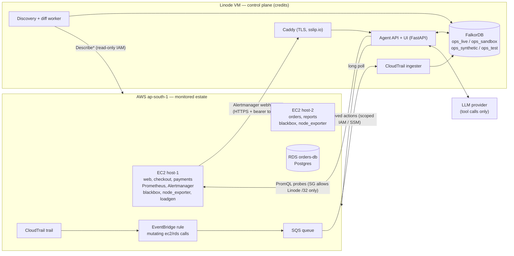

# Graph Hacks — Implementation Plan (v2)

> **v2 changes:** we build the sandbox first, cut scope early, have a go/no-go gate on Saturday at 20:00, make the LLM's agent role visible, fix `check_path` for resources with several security groups, use a fixed depth in `blast_radius`, detect modified SG rules, and serve the webhook over TLS. `improvement.md` explains why. The sections that changed are marked **(v2)**.

**Hackathon:** WeMakeDevs × FalkorDB "Graph Hacks: Context for AI Agents"
**Deadline:** Sun 18 Oct 2026, 11:59 PM IST. **We submit by 10:00 PM.**
**Team:** 3 people, all building with AI coding assistants
**Primary track:** 01, Agents That Act on Connected Data (Track 02 as well if the organisers confirm multi-track entries)
**Working title:** `rootgraph` (rename freely)

---

## 0. TL;DR

We're building an incident responder that knows how our AWS estate is wired.

When several alerts fire at once, it:
1. Walks the graph **upward** from the symptoms to the node that explains them.
2. Proves the conclusion with the network/dependency path.
3. Finds the infrastructure change behind it (CloudTrail, streamed into FalkorDB).
4. Proposes a reversible fix that a human approves.
5. Remembers the incident, so the next one is faster.

FalkorDB isn't a side store. Every conclusion the agent reaches comes out of a Cypher query.

**One-line pitch (v2):** *the graph decides, the agent investigates and explains, a human acts.*

**Build order (v2):** the replay sandbox works end to end first. Live AWS is the upgrade on top of it, so it can never be the only path to a demo.

---

## 1. Constraints that shape this plan

| Rule | What it means for us |
|---|---|
| FalkorDB must be primary and central; "if the product works without FalkorDB, the graph is decoration" | Discovery, correlation, path checks, change history and memory all live in the graph. No side database. |
| Main coding starts after kickoff | Fine, we're starting now. |
| Data must be public, synthetic or our own | Our own AWS account plus clearly labelled synthetic fixtures. |
| Required in the submission: public repo, README with setup + graph data model, the Cypher queries / algorithms the product depends on, demo video, live deployment (or full local setup), track name | See §18 checklist. |
| AI coding assistants allowed but **must be disclosed**; participants must be able to explain the graph model, queries, architecture and decisions; fully AI-generated projects without real understanding may be rejected | See §15 guardrails. This is a real risk for a team that is building with AI assistants. |

**Track ambiguity:** the FAQ and rules say you can enter several tracks. The organiser blog says one submission is judged in one track. Ask in the FalkorDB Discord during Phase 0.

**Competitive context:** the organisers' walkthrough blog builds "Blast Radius", an on-call agent over a hand-seeded service dependency graph. Judges will compare us to it. Our differentiation goes in the first 20 seconds of the video and the first section of the README:

| Blast Radius (organiser demo) | rootgraph |
|---|---|
| Hand-seeded graph | Graph discovered live from AWS + Prometheus, kept current by diffing |
| Downward: "what breaks if X fails" | Upward: "given these N alerts, which node explains them" |
| Service dependencies only | Services + hosts + networks + security-group rules: catches "dependency exists, network path doesn't" |
| Answers questions | Proposes and executes a fix, gated by the graph and a human |
| Findings as memory | Incidents, root causes, changes and verified fixes as memory, recalled by alert cues |

---

## 2. What we are building

### In scope

- **(v2) First: a replay sandbox.** Recorded Alertmanager + CloudTrail payloads go into `ops_sandbox`, then through the full investigation, and the UI shows it. This is the backbone of the demo.
- Live discovery of an AWS estate into FalkorDB:
  - EC2, RDS, security groups and rules, VPC/subnets;
  - service dependencies from a declared catalogue (`services.yaml`). *(v2: observed-traffic dependencies moved to stretch.)*
- CloudTrail streamed into FalkorDB as `Change` nodes linked to the resources they touched. A graph-diff detector backs it up.
- Prometheus + Alertmanager alerts become `Alert` nodes. Alertmanager's webhook starts the agent.
- An investigation pipeline built from fixed, typed Cypher tools, plus a transparent scoring step. The LLM drives tool choice and writes the explanation; a validator keeps it honest.
- Human-approved remediation from a fixed action catalogue. Each proposal shows its own blast radius and rollback.
- Verification loop: did the alerts clear?
- Memory written back to the graph.
- Web UI: incident view, highlighted path, scorecard, tool trace with the Cypher used, Approve/Reject.
- Public sandbox on Linode: fixture graph + replayable scenarios.

### Non-goals (say no fast)

- No LLM-written Cypher, shell commands or cloud API calls.
- No automatic execution without approval.
- No log or time-series analysis by the LLM. PromQL is fixed, inside tools.
- No Kubernetes, no Grafana, no second monitored cloud (see stretch goals).
- **(v2) Cut now, not when we fall behind:** observed dependencies, the `ops_synthetic` estate, chat mode, the MCP wrapper. All four are stretch goals now (§17).

---

## 3. Decisions log

| # | Decision | Why |
|---|---|---|
| D1 | **Monitor AWS only.** Linode (credits) hosts the control plane: FalkorDB, agent, UI and the public sandbox. Monitoring Linode is a stretch goal. | CloudTrail streaming already commits us to AWS. A second monitored cloud means a second discovery adapter, firewall model and change feed: about a third of the build for 3 people. |
| D2 | **CloudTrail → EventBridge → SQS → ingester → FalkorDB.** The agent never queries CloudTrail; it reads `Change` nodes from the graph. | Team decision. It also makes the audit trail part of the graph the agent traverses. |
| D3 | **Human-approved actions only**, from a fixed catalogue. | Safety. It's the first thing judges will probe. |
| D4 | The agent picks from fixed tools; humans write every Cypher query. | Correctness, explainability, no injection. |
| D5 | Python 3.12 everywhere: `falkordb`, `boto3`, FastAPI, `prometheus_client`. | One language for 3 people building with AI assistants. |
| D6 | Grafana cut. Optional video backdrop only if there is spare time. | Scores nothing; Prometheus UI is enough for debugging. |
| D7 | No Graphiti / GraphRAG-SDK. Use the raw `falkordb` client. | Our memory is structured, plain Cypher is easier to explain, and there's nothing between us and the bug. |
| D8 | The official FalkorDB MCP server is a dev aid only. The agent doesn't use it. | It allows arbitrary Cypher, which D4 forbids. |
| D9 | AWS region `ap-south-1` (Mumbai). | Latency, and it's where we are. |
| D10 | LLM provider: **TBD**, behind one adapter (`agent/llm.py`). Needs function calling. | Decide in Phase 0; it's a config line. |
| D11 | **(v2) Sandbox first.** Replay → investigation → UI works by M1 (Sat 13:00), before live AWS is connected. | Any live AWS piece can break; the demo must survive it. |
| D12 | **(v2) Pre-cut** observed deps, synthetic estate, chat mode, MCP. | They add little to the story and take time from the critical path. |
| D13 | **(v2) Go/no-go at Sat 20:00.** If live S1 doesn't reach a proposed fix, live work stops and we polish the sandbox. | Stops a night of debugging AWS from eating Sunday. |
| D14 | **(v2) TLS on the control plane.** Caddy in front of FastAPI with an `sslip.io` hostname (automatic Let's Encrypt). | A bearer token over plain HTTP can be read in transit. Takes about 10 minutes. |
| D15 | **(v2) The agent's own tool calls are visible.** Each LLM tool call carries a `reason`, and the UI marks it "agent-chosen". | Answers "where's the agent?" for Track 01. |
| D16 | **(v2) Log tokens per investigation from day one.** | Cheap to collect, and a strong number for the README and blog. |

---

## 4. Architecture



**Where things run**

| Component | Runs on | Notes |
|---|---|---|
| Demo services (one image, 5 instances) | EC2 host-1, host-2 | Docker Compose |
| Prometheus, Alertmanager, blackbox, node_exporter, loadgen | EC2 host-1 (blackbox + node_exporter on both hosts) | 5s scrape interval |
| RDS `orders-db` | AWS | Smallest instance class, single-AZ, own security group |
| FalkorDB | Linode | Password set via `REDIS_ARGS="--requirepass ..."`. **Never expose 6379 or 3000 publicly.** |
| Agent API + UI, discovery worker, ingester, Caddy | Linode | One Compose file. Caddy is the only public port (443). |
| Local development | Laptops | `docker run -p 6379:6379 -p 3000:3000 falkordb/falkordb:latest`; work against `ops_test` fixtures |

**Graphs (FalkorDB multigraph):**
- `ops_live`: real AWS.
- `ops_sandbox`: fixture + replay, public demo.
- `ops_synthetic`: *(v2: stretch)* 30–40-node labelled synthetic estate, for ranking and scale.
- `ops_test`: pytest.

---

## 5. Graph model (v1 — FROZEN after Phase 0; changes need all three people to agree)

### Conventions

- Every infrastructure node has the label `:Resource` plus a kind label, and a unique `rid`.
- `rid` formats:
  - `svc:<name>`
  - EC2 instance id `i-…`
  - `rds:<db-identifier>`
  - security group id `sg-…`
  - `vpc-…`, `subnet-…`
  - `internet`
  - `cidr:<block>`
- Every node and edge from discovery carries `source` (`aws_api | declared | observed | agent`) and `last_seen` (epoch seconds).
- Timestamps are **epoch seconds (int)** everywhere.
- Every `DEPENDS_ON` and `RUNS_ON` edge has `weight` (default 1) so `algo.SPpaths` works.

### Nodes

| Label(s) | Key properties | Source |
|---|---|---|
| `Resource:Service` | rid, name, port | `services.yaml` |
| `Resource:Compute` | rid, name, private_ip, public_ip, state, instance_type | EC2 describe |
| `Resource:Database` | rid, name, engine, endpoint, port, status | RDS describe |
| `Resource:Firewall` | rid, name, kind=`security_group` | EC2 describe |
| `Resource:Network` | rid, kind (`vpc`/`subnet`), cidr | EC2 describe |
| `Resource:Internet` / `Resource:CidrBlock` | rid, cidr | Derived from SG rules |
| `Alert` | id (=fingerprint + ":" + starts_at), fingerprint, alertname, severity, status, starts_at, ends_at | Alertmanager |
| `Change` | event_id, source (`cloudtrail`/`graph_diff`), event_name, actor, at, by_agent, request (trimmed JSON) | Stream / diff |
| `Incident` | id, group_key, opened_at, closed_at, status, summary, ttr_seconds | Agent |
| `Action` | id, kind, params (JSON), status (`proposed/approved/rejected/executed/verified/failed`), proposed_at, approved_by, executed_at | Agent |
| `Finding` | id, text, at, confidence | Agent (validated text) |

> The Alert `id` includes `starts_at` on purpose. Alertmanager fingerprints are stable per label set, so a repeat of the same alert (scenario 4) would otherwise reuse the old node.

### Edges

```
(:Service)-[:DEPENDS_ON {kind: http|db, port, source: declared|observed, weight, last_seen}]->(:Service|:Database)
(:Service)-[:RUNS_ON {weight}]->(:Compute)
(:Compute|:Database)-[:IN]->(:Network {kind:'subnet'})-[:IN]->(:Network {kind:'vpc'})
(:Firewall)-[:PROTECTS]->(:Compute|:Database)
(:Firewall)-[:ALLOWS_FROM {rule_id, proto, port_from, port_to, active, last_seen, removed_at}]->(:Firewall|:Compute|:CidrBlock|:Internet)
(:Alert)-[:FIRING_ON]->(:Resource)
(:Alert)-[:TARGET]->(:Resource)                 // blackbox probes: what the probe was trying to reach
(:Change)-[:MODIFIED]->(:Resource)
(:Incident)-[:HAS_ALERT]->(:Alert)
(:Incident)-[:SUSPECTS {score, rank}]->(:Resource)
(:Incident)-[:ROOT_CAUSE]->(:Resource)
(:Incident)-[:EXPLAINED_BY]->(:Change)
(:Action)-[:FOR]->(:Incident)
(:Action)-[:TARGETS]->(:Resource)
(:Action)-[:RESOLVED]->(:Incident)
(:Finding)-[:ABOUT]->(:Resource|:Incident)
```

**Security-group modelling rules**
- `ALLOWS_FROM` points from the protecting SG to the **source** of allowed traffic.
- SG-to-SG references become an edge to that `Firewall`.
- A `/32` matching a known host becomes an edge to that `Compute`.
- `0.0.0.0/0` becomes an edge to `Internet`.
- Any other CIDR becomes an edge to a `CidrBlock`.
- Ingress rules only for v1.
- Removed rules are **never deleted**. They get `active=false` and `removed_at`. That history is what lets us restore the exact rule.

### Indexes (`graph/schema.cypher`)

```cypher
CREATE INDEX FOR (r:Resource) ON (r.rid)
CREATE INDEX FOR (a:Alert) ON (a.id)
CREATE INDEX FOR (c:Change) ON (c.event_id)
CREATE INDEX FOR (i:Incident) ON (i.id)
CREATE INDEX FOR (x:Action) ON (x.id)
```

---

## 6. Ingestion

### 6.1 AWS discovery (`ingest/discovery_aws.py`)

- **Calls:** `describe_instances`, `describe_security_groups`, `describe_security_group_rules` (gives `sgr-…` rule ids), `describe_vpcs`, `describe_subnets`, `rds.describe_db_instances`.
- **Upserts:** MERGE on `rid`, SET properties, `last_seen = sync_ts`, `active = true` on rules.
- **Schedule:** full sync every 60s. Targeted `resync(rid)` on demand when an incident opens, which runs the diff immediately.
- **Missing resources:** set `state = 'missing'`. Never delete.

### 6.2 Graph diff, the backup change detector (`ingest/diff.py`)

After syncing a firewall, any active `ALLOWS_FROM` edge with `last_seen < sync_ts` was removed:
- mark it `active=false, removed_at=sync_ts`;
- create `Change {source:'graph_diff', event_name:'SecurityGroupRuleRemoved'}` linked to the SG.

**Why:** CloudTrail → EventBridge is near real-time but not instant. The diff guarantees the demo never waits on it.

**(v2) Modified rules.** `ModifySecurityGroupRules` edits a rule in place and keeps its `sgr-` id. A diff based only on `last_seen` misses that. W1 alone would also overwrite the old values, so we'd lose the history `restore_firewall_rule` needs. So, before running W1 for each rule, discovery runs **W1b** (§8):
- if the stored edge differs (proto, ports or source), mark the old edge `active=false, removed_at=sync_ts`;
- create `Change {source:'graph_diff', event_name:'SecurityGroupRuleModified', before, after}`;
- then run W1 to write the new edge. If only the ports changed, W1 would MERGE onto the edge we just retired, so W1b first gives the old edge a suffixed `rule_id` (`<rule_id>@<removed_at>`).

### 6.3 CloudTrail stream (`ingest/cloudtrail_stream.py`), per decision D2

**AWS setup** (documented in `demo/aws/setup.md`):
1. Create a **CloudTrail trail with logging enabled.** EventBridge only receives "AWS API Call via CloudTrail" events when a trail is logging.
2. Create an EventBridge rule. The default rule state already excludes read-only events, which suits us. Pattern:

```json
{
  "source": ["aws.ec2", "aws.rds"],
  "detail-type": ["AWS API Call via CloudTrail"],
  "detail": {
    "eventName": [
      "RevokeSecurityGroupIngress", "AuthorizeSecurityGroupIngress", "ModifySecurityGroupRules",
      "StopInstances", "StartInstances", "RebootInstances", "TerminateInstances", "ModifyInstanceAttribute",
      "ModifyDBInstance", "RebootDBInstance", "StopDBInstance"
    ]
  }
}
```
3. Point the rule at an SQS queue `rootgraph-changes`, with a queue policy allowing `events.amazonaws.com`.

**Ingester loop:**
1. Long-poll SQS (`WaitTimeSeconds=20`).
2. Extract resource ids from `detail.requestParameters` using an extractor table, e.g.:
   - SG events → `groupId`
   - instance events → `instancesSet.items[].instanceId`
   - RDS events → `dBInstanceIdentifier` → `rds:<id>`
3. MERGE a `Change` and link it to the resources.
4. Trigger `resync(rid)`.
5. Delete the message.

**First task for the owner:** record one real `RevokeSecurityGroupIngress` event and save it to `ingest/fixtures/`. Don't guess payload shapes.

**Field mapping:**
- `actor` = `detail.userIdentity.arn`
- `at` = `detail.eventTime` → epoch
- `by_agent = true` when `actor` is the executor role. The agent's own fix shows up in CloudTrail too, and must not be treated as a new suspect.

**Unknown resource ids:** keep the `Change` with an `unlinked_rids` property, then resync.

### 6.4 Service dependencies

- **Declared:** `ingest/services.yaml` lists each service, its host, and its dependencies (with ports).
- **Observed (v2: stretch, build only after M2):** demo services emit `http_client_requests_total{rid, target_rid}` and `db_client_queries_total{rid, target_rid}`. A job queries `sum by (rid, target_rid)(rate(...[5m])) > 0` and MERGEs `DEPENDS_ON {source:'observed'}`.
- A declared edge with no traffic, or traffic with no declared edge, is reported as a finding.

### 6.5 Alerts (`ingest/alerts.py`)

- Alertmanager webhook → `POST /hooks/alertmanager` (bearer token).
- Each alert becomes an `Alert` node linked with `FIRING_ON` to its `rid`, and with `TARGET` to its `target_rid` if present.
- **Grouping:** one Alertmanager group = one `Incident` (keyed on `groupKey`). If an incident is open and less than 10 minutes old, new alerts attach to it.
- `send_resolved: true`. Resolved notifications drive verification.

---

## 7. Agent

### 7.1 Tool catalogue

All tools take typed arguments. Every `rid` argument is resolved against the graph first; if it doesn't resolve, the tool returns `unknown_resource` and no query runs.

| Tool | Kind | What it answers |
|---|---|---|
| `resolve(name_or_rid)` | read | Does this exist? Canonical rid |
| `correlate_alerts(alert_rids, k)` | read | Upstream nodes ranked by how many alerting nodes they explain |
| `check_path(from_svc, to_rid)` | read | Is the network route for this dependency permitted? Which rule permits it, or which hop is missing |
| `recent_changes(rid, minutes)` | read | `Change` nodes on the resource and its 2-hop infrastructure neighbourhood |
| `blast_radius(rid, depth)` | read | Everything upstream that depends on this |
| `path_between(from, to)` | read | Shortest dependency path (`algo.SPpaths`) |
| `probe(rid)` | read | Fixed PromQL per node kind: up, error rate, p95, CPU, blackbox reachability from every host |
| `recall_incidents(alertnames, candidate_rids)` | read | Past resolved incidents matched by cues |
| `load_bearing(limit)` | read | PageRank over `DEPENDS_ON` |
| `resync(rid)` | read+diff | Re-discover a resource and emit diff `Change`s |
| `propose_action(kind, target_rid)` | write (graph only) | Creates an `Action {status:'proposed'}` with its blast radius and rollback |
| `execute_action(action_id)` | **act** | Only if `status='approved'` (set by the UI, never by the LLM) |
| `record_finding(text, about_rids)` | write | Validated text only |

### 7.2 Tool return contract (`agent/tools.py`), frozen in Phase 0

```json
{
  "tool": "check_path",
  "args": {"from_svc": "svc:payments", "to_rid": "rds:orders-db"},
  "outcome": "answered_with_path | answered_from_memory | not_in_graph | unknown_resource | error",
  "rows": [],
  "paths": [["svc:payments", "i-0host1", "sg-db"]],
  "cypher": "MATCH ...",
  "ms": 12
}
```

`not_in_graph` is **not** "healthy". It means the graph doesn't model this relationship, and the UI must say so.

### 7.3 Investigation pipeline (`agent/investigate.py`)

1. **Open:** create the `Incident`, link its alerts, and `resync` every alerting resource plus its firewalls.
2. **Recall:** `recall_incidents` with cues (alert names + alerting rids). Matches are shown first.
3. **Suspects:** `correlate_alerts` returns the top 5 by coverage.
4. **Paths:** for every `DEPENDS_ON` edge leaving an alerting service or a suspect, run `check_path`. Each broken path adds the `Firewall` that protects the dependency as a candidate.
5. **Evidence per candidate:**
   - `probe` (healthy / unhealthy / unknown);
   - `recent_changes` (last 30 min);
   - sibling evidence for databases: do *other* dependents still reach it?
6. **Score** (§7.4) and write `SUSPECTS {score, rank}`.
7. **LLM investigation** (§7.5, v2). The LLM reads the scorecard and may call up to 6 read tools of its own choice, each with a `reason`. It may change the ranking only by producing new evidence that the validator accepts. Then it returns structured output.
8. **Validate.** Fall back to a template answer from the top candidate if validation fails.
9. **Propose** an action from the catalogue and show it in the UI.
10. **Human approves**, then execute, then **verify**: poll every 5s for up to 120s for resolved alerts plus healthy probes.
11. **Memory:**
    - `ROOT_CAUSE`, `EXPLAINED_BY`, `Action -[:RESOLVED]->`, `Finding`;
    - `status='resolved'`, `ttr_seconds`;
    - or `failed`, surfaced to the human.

### 7.4 Scoring (deterministic, shown in the UI as a scorecard)

```
score = 3.0 * coverage_ratio          # alerting nodes explained / total alerting nodes
      + 2.0 * probe_unhealthy         # candidate's own probe fails
      - 2.0 * probe_healthy           # candidate positively healthy (incl. sibling evidence)
      + 2.0 * broken_path             # candidate is a firewall on a broken dependency path
      + 2.0 * change_in_window        # a Change MODIFIED it in the last 30 min
      + 1.0 * prior_incident_match    # recall found a resolved incident with this root cause
      - 0.25 * min_hops
```

A firewall candidate inherits the coverage of the alerting services whose dependency chain crosses the broken edge.

The weights are heuristic. Tune them only with `tests/test_scenarios.py` and say so in the README.

**Expected results (these are the test oracles):**

| Scenario | Top candidate | Why the runner-up loses |
|---|---|---|
| S1 SG rule revoked | `sg-db` (≈6.2) | `host-1` covers the most alerts but probes healthy; `payments` is a victim (path broken downstream) |
| S2 CPU hog on host-2 | `i-host2` (≈5.0) | `orders` only explains part of the alert set |
| S3 payments stopped | `svc:payments` (≈5.0) | `host-1` probes healthy; no changes |
| S4 repeat of S1 | `sg-db` + recalled INC | Memory match adds +1 and pre-fills the fix |
| **S5 (v2, fixtures only) two faults at once:** SG rule revoked + `payments` stopped | Both `sg-db` and `svc:payments` in the top 2, close scores | **A documented limitation.** The scorecard ranks causes but doesn't split the alerts between them. The test asserts both are in the top 2 and the UI shows "multiple likely causes" when the gap is < 1.0. |

**(v2) Why S5:** judges will ask whether the weights only fit our four scenarios. S5 shows a case where scoring doesn't give one clear answer, and how the product reports that honestly instead of hiding it.

### 7.5 What the LLM does, and how it is constrained

**Input:** a compact evidence bundle (scorecard + tool envelopes). Never the whole graph. Context stays small and doesn't grow with history; we measure tokens per investigation for the README and blog.

**(v2) What makes it an agent, not a summariser:**
- The LLM gets the read tools (`check_path`, `recent_changes`, `probe`, `blast_radius`, `path_between`, `recall_incidents`, `resync`) as function calls and decides which to run, up to 6.
- Each call must include a `reason` string ("host-1 covers the most alerts; checking whether it's actually healthy"). Calls without one are rejected.
- In the UI's tool trace, its calls are marked **agent-chosen**, and pipeline calls are marked **pipeline**.
- `agent/llm.py` logs `input_tokens`, `output_tokens` and tool-call count to the `Incident` node (`tokens_in`, `tokens_out`, `agent_calls`) from the first commit.
- **Pitch line:** "The graph decides, the agent investigates and explains, a human acts."

**Output (JSON):**
```json
{"root_cause_rid": "...", "explanation": "...", "evidence_tools": ["..."], "proposed_action": {"kind": "...", "target_rid": "..."}}
```

**Validator (`agent/validator.py`), modelled on the organiser blog's `accepts()`:**
- `root_cause_rid` must be among the scored candidates.
- Every rid- or name-like token in `explanation` must appear in the evidence.
- `proposed_action.kind` must be in the catalogue, and its preconditions must hold.
- If the traversal was empty, the text must not claim impact.
- **(v2)** `evidence_tools` must name at least one tool call that returned rows. If `root_cause_rid` differs from the scorecard's top candidate, at least one of those must be an agent-chosen call.

On failure, a template sentence built from the top-ranked row goes out instead.

**Chat mode (stretch):** the on-call engineer asks free-form questions ("what changed near payments?"). The LLM uses read tools only.

### 7.6 Action catalogue (`agent/actions.py`)

| kind | Target | Executor | Preconditions | Rollback | Shown before approval |
|---|---|---|---|---|---|
| `restore_firewall_rule` | Firewall | `ec2.authorize_security_group_ingress`, spec from the inactive `ALLOWS_FROM` edge | Inactive edge with `removed_at` inside the incident window | Revoke the re-added rule | The exact rule (proto/port/source) and who gains access |
| `restart_service` | Service | AWS SSM Run Command `docker start <svc>` on its host | `probe` says down | n/a | `blast_radius(service)`: dependents may blip |
| `reboot_compute` | Compute | `ec2.reboot_instances` | Stretch only | n/a | Everything that `RUNS_ON` it |

**State machine:** `proposed → approved|rejected → executed → verified|failed`.

Only the UI's Approve button (an authenticated human) sets `approved`. The LLM can only propose.

### 7.7 IAM

| Principal | Permissions |
|---|---|
| `rootgraph-discovery` | `ec2:Describe*`, `rds:Describe*` |
| `rootgraph-ingester` | `sqs:ReceiveMessage`, `sqs:DeleteMessage` on the queue |
| `rootgraph-executor` | `ec2:AuthorizeSecurityGroupIngress` on `sg-db` only; `ssm:SendCommand` on instances tagged `rootgraph=demo` |
| `rootgraph-prober` | (none; PromQL over HTTP, SG allows Linode /32 on 9090) |
| Linode firewall (v2) | Inbound 443 only (Caddy) + SSH from team IPs. 6379, 3000 and 8000 are closed. |
| Fault scripts | A human's own credentials (they play the person who made the bad change) |

Keys go in `.env`, which is never committed. Run `gitleaks` before every push. Rotate all keys after the event.

---

## 8. Core Cypher (draft)

> Run every query in FalkorDB Browser against `graph/fixtures/estate.cypher` during Phase 0. FalkorDB implements a subset of openCypher, so check `docs.falkordb.com/cypher/known-limitations`. Specifically verify:
> - multi-type variable-length patterns (`[:A|B*1..4]`);
> - zero-length (`*0..`) paths;
> - pattern predicates inside `WHERE`.
>
> If any are unsupported, split the query and combine the results in Python.
>
> **(v2)** Also verify: `sum()` over `size()` of collected lists (Q4); `src IN list_of_nodes` (Q4); `collect(...)[0]` (Q6); the `FOREACH`/`CASE` pattern (W6). Q4 is the first query to test in Phase 0.

**Q1 resolve**
```cypher
MATCH (r:Resource) WHERE r.rid = $x OR r.name = $x
RETURN r.rid AS rid, labels(r) AS kinds LIMIT 1
```

**Q2 correlate_alerts (upward from symptoms)**
```cypher
UNWIND $alert_rids AS rid
MATCH p = (s:Resource {rid: rid})-[:DEPENDS_ON|RUNS_ON*0..4]->(c:Resource)
WITH c, rid, min(length(p)) AS hops
WITH c, collect(rid) AS explains, min(hops) AS min_hops
RETURN c.rid AS candidate, labels(c) AS kinds, size(explains) AS coverage, explains, min_hops
ORDER BY coverage DESC, min_hops ASC
LIMIT $k
```

**Q3 path_between (shortest dependency path)**
```cypher
MATCH (a:Resource {rid: $from}), (b:Resource {rid: $to})
CALL algo.SPpaths({sourceNode: a, targetNode: b, relTypes: ['DEPENDS_ON','RUNS_ON'],
                   relDirection: 'outgoing', weightProp: 'weight', pathCount: 1})
YIELD path, pathWeight
RETURN [n IN nodes(path) | n.rid] AS hops, pathWeight
```

**Q4 check_path (is the network route for a dependency permitted?) (v2)**

AWS allows traffic if **any** security group on the target allows it. So the verdict is computed across all of the target's firewalls, not one row per firewall. The host's own SGs are collected up front, so the query needs no pattern predicate inside `WHERE` (one of the FalkorDB gaps we flagged).

```cypher
MATCH (x:Service {rid: $from})-[:RUNS_ON]->(h:Compute)
MATCH (x)-[d:DEPENDS_ON]->(y:Resource {rid: $to})
MATCH (fw:Firewall)-[:PROTECTS]->(y)
OPTIONAL MATCH (hfw:Firewall)-[:PROTECTS]->(h)
WITH h, d, collect(DISTINCT fw) AS target_fws, collect(DISTINCT hfw) AS host_fws
UNWIND target_fws AS fw
OPTIONAL MATCH (fw)-[r:ALLOWS_FROM]->(src)
  WHERE r.active = true
    AND r.port_from <= d.port AND d.port <= r.port_to
    AND (src = h OR src:Internet OR src IN host_fws)
WITH h, d, fw, collect(r.rule_id) AS rules
RETURN h.rid AS host, d.port AS port,
       collect({firewall: fw.rid, rules: rules}) AS per_firewall,
       sum(size(rules)) > 0 AS permitted
```

How to read the result:
- `permitted = false`: **broken path**. Every firewall on the target is a candidate. The one with an inactive `ALLOWS_FROM` removed in the incident window is the prime suspect.
- No rows: no firewall modelled (`not_in_graph`).
- Known v1 limitation: a `CidrBlock` source that *contains* the host's IP isn't matched (only exact `/32` → `Compute`). The README says so.

**Q5 recent_changes (resource + 2-hop infrastructure neighbourhood)**
```cypher
MATCH (r:Resource {rid: $rid})-[:RUNS_ON|PROTECTS|DEPENDS_ON|IN*0..2]-(n:Resource)
WITH DISTINCT n
MATCH (ch:Change)-[:MODIFIED]->(n)
WHERE ch.at >= $since
RETURN ch.event_id, ch.source, ch.event_name, ch.actor, ch.at, ch.by_agent, n.rid AS on_resource
ORDER BY ch.at DESC LIMIT 10
```

**Q6 blast_radius (what depends on this) (v2)**

Cypher doesn't accept parameters as variable-length bounds, so the upper bound is fixed at 4 and `$depth` filters on the result.
```cypher
MATCH p = (up:Resource)-[:DEPENDS_ON|RUNS_ON*1..4]->(t:Resource {rid: $rid})
WHERE length(p) <= $depth
WITH up, min(length(p)) AS hops, collect([n IN nodes(p) | n.rid])[0] AS via
RETURN up.rid AS affected, hops, via
ORDER BY hops, affected
```

**Q7 recall_incidents (cue-triggered memory)**
```cypher
MATCH (i:Incident {status: 'resolved'})-[:ROOT_CAUSE]->(rc:Resource)
OPTIONAL MATCH (i)-[:HAS_ALERT]->(al:Alert)
WITH i, rc, collect(DISTINCT al.alertname) AS past_alerts
WITH i, rc, size([a IN past_alerts WHERE a IN $alertnames]) AS alert_overlap,
     CASE WHEN rc.rid IN $candidate_rids THEN 1 ELSE 0 END AS same_cause
WHERE alert_overlap > 0 OR same_cause = 1
OPTIONAL MATCH (i)-[:EXPLAINED_BY]->(ch:Change)
OPTIONAL MATCH (act:Action {status: 'verified'})-[:RESOLVED]->(i)
RETURN i.id, i.opened_at, i.ttr_seconds, rc.rid AS root_cause, ch.event_name AS change,
       act.kind AS fix, act.params AS fix_params, alert_overlap, same_cause
ORDER BY same_cause DESC, alert_overlap DESC, i.opened_at DESC
LIMIT 3
```

**Q8 load_bearing**
```cypher
CALL algo.pageRank('Resource', 'DEPENDS_ON') YIELD node, score
RETURN node.rid AS resource, score ORDER BY score DESC LIMIT $limit
```

**W1 upsert SG rule (discovery)**
```cypher
MATCH (fw:Firewall {rid: $fw}), (src:Resource {rid: $src_rid})
MERGE (fw)-[r:ALLOWS_FROM {rule_id: $rule_id}]->(src)
SET r.proto = $proto, r.port_from = $from_port, r.port_to = $to_port,
    r.active = true, r.last_seen = $sync_ts, r.removed_at = null
```

**W1b detect a modified rule (v2, runs before W1 for each rule)**
```cypher
MATCH (fw:Firewall {rid: $fw})-[r:ALLOWS_FROM {rule_id: $rule_id}]->(src)
WHERE r.active = true
  AND (r.proto <> $proto OR r.port_from <> $from_port OR r.port_to <> $to_port OR src.rid <> $src_rid)
SET r.active = false, r.removed_at = $sync_ts,
    r.rule_id = $rule_id + '@' + toString($sync_ts), r.original_rule_id = $rule_id
CREATE (ch:Change {event_id: 'diff:mod:' + $rule_id + ':' + toString($sync_ts), source: 'graph_diff',
                   event_name: 'SecurityGroupRuleModified', at: $sync_ts, rule_id: $rule_id,
                   before: r.proto + ' ' + toString(r.port_from) + '-' + toString(r.port_to) + ' from ' + src.rid})
CREATE (ch)-[:MODIFIED]->(fw)
RETURN r.rule_id
```

**W2 graph diff (rules that vanished)**
```cypher
MATCH (fw:Firewall {rid: $fw})-[r:ALLOWS_FROM]->(src)
WHERE r.active = true AND r.last_seen < $sync_ts
SET r.active = false, r.removed_at = $sync_ts
CREATE (ch:Change {event_id: 'diff:' + r.rule_id + ':' + toString($sync_ts), source: 'graph_diff',
                   event_name: 'SecurityGroupRuleRemoved', at: $sync_ts, rule_id: r.rule_id})
CREATE (ch)-[:MODIFIED]->(fw)
RETURN r.rule_id, src.rid
```

**W3 ingest CloudTrail change**
```cypher
MERGE (ch:Change {event_id: $event_id})
ON CREATE SET ch.source = 'cloudtrail', ch.event_name = $event_name, ch.actor = $actor,
              ch.at = $at, ch.by_agent = $by_agent, ch.request = $request_json
WITH ch
UNWIND $rids AS rid
MATCH (r:Resource {rid: rid})
MERGE (ch)-[:MODIFIED]->(r)
```

**W4 ingest alert**
```cypher
MERGE (a:Alert {id: $id})
SET a.fingerprint = $fp, a.alertname = $alertname, a.status = $status,
    a.severity = $severity, a.starts_at = $starts_at, a.ends_at = $ends_at
WITH a
MATCH (r:Resource {rid: $rid})
MERGE (a)-[:FIRING_ON]->(r)
```

**W5 open incident**
```cypher
CREATE (i:Incident {id: $id, group_key: $group_key, opened_at: $now, status: 'open'})
WITH i
UNWIND $alert_ids AS aid
MATCH (a:Alert {id: aid})
MERGE (i)-[:HAS_ALERT]->(a)
```

**W6 close incident with memory**
```cypher
MATCH (i:Incident {id: $id}), (rc:Resource {rid: $root_rid}), (act:Action {id: $action_id})
SET i.status = 'resolved', i.closed_at = $now, i.ttr_seconds = $now - i.opened_at, i.summary = $summary
MERGE (i)-[:ROOT_CAUSE]->(rc)
MERGE (act)-[:RESOLVED]->(i)
WITH i
OPTIONAL MATCH (ch:Change {event_id: $change_id})
FOREACH (_ IN CASE WHEN ch IS NULL THEN [] ELSE [1] END | MERGE (i)-[:EXPLAINED_BY]->(ch))
```

All final queries also live as files in `graph/queries/` and are copied into the README (a submission requirement).

---

## 9. Demo estate on AWS

### 9.1 Resources

| Resource | Spec | Security group |
|---|---|---|
| `host-1` EC2 | Small burstable instance, Amazon Linux (SSM agent preinstalled), instance profile with `AmazonSSMManagedInstanceCore`, tag `rootgraph=demo` | `sg-host1` |
| `host-2` EC2 | Same | `sg-host2` |
| `orders-db` RDS Postgres | Smallest class, single-AZ, 20 GB | `sg-db`: 5432 from `sg-host1` (rule A) and from `sg-host2` (rule B) |

Set up an **AWS Budget alarm at $10** before creating anything, and write a teardown script on day one.

### 9.2 Services (one FastAPI image, configured by env)

```
host-1:  web      → checkout, orders
         checkout → payments
         payments → orders-db (5432)
host-2:  orders   → orders-db
         reports  → orders-db
```

- Each service exposes `/metrics`: `http_requests_total`, `http_request_duration_seconds`, client metrics with `target_rid`.
- `loadgen` hits `web` continuously.
- **No restart policy on demo services**, so faults stick until fixed.

### 9.3 Prometheus (`demo/prometheus/`)

- `scrape_interval: 5s`, `evaluation_interval: 5s`.
- Every target gets a static `rid` label matching the graph. **This is the alert↔graph contract.**
- Blackbox `tcp_connect` probe to `orders-db:5432` from **each** host, labels `rid=<host instance id>`, `target_rid=rds:orders-db`.

```yaml
groups:
- name: rootgraph
  rules:
  - alert: HighErrorRate
    expr: sum by (rid) (rate(http_requests_total{code=~"5.."}[30s])) / sum by (rid) (rate(http_requests_total[30s])) > 0.2
    for: 15s
  - alert: HighLatencyP95
    expr: histogram_quantile(0.95, sum by (rid, le) (rate(http_request_duration_seconds_bucket[30s]))) > 1
    for: 15s
  - alert: ServiceDown
    expr: up{job="services"} == 0
    for: 10s
  - alert: DependencyUnreachable
    expr: probe_success{job="blackbox_db"} == 0
    for: 15s
  - alert: HostCpuSaturated
    expr: 100 * (1 - avg by (rid) (rate(node_cpu_seconds_total{mode="idle"}[30s]))) > 90
    for: 20s
```

### 9.4 Alertmanager

- `group_by: ['env']`, `group_wait: 10s`, `group_interval: 10s`, `repeat_interval: 1h`.
- Webhook to `https://<linode>/hooks/alertmanager` with a bearer token (`http_config.authorization`).
- `send_resolved: true`.

### 9.5 Fault scripts (`demo/faults/`)

| Script | Does | Restore |
|---|---|---|
| `s1_revoke_sg.sh` | Revokes rule A (5432 from `sg-host1`) on `sg-db` with a human's credentials | Agent fixes it; `restore_all.sh` as backup |
| `s2_cpu_hog.sh` | `stress-ng --cpu 0 --timeout 300` on host-2 via SSM | Times out |
| `s3_stop_payments.sh` | `docker stop payments` on host-1 via SSM | Agent restarts it |
| `restore_all.sh` | Puts everything back | n/a |

---

## 10. Demo scenarios (each is a test: fixture version in pytest, live version rehearsed)

### S1: Security-group rule revoked (headline)

- **Fault:** rule letting host-1 reach `orders-db` is revoked.
- **Alerts:**
  - `HighErrorRate` on payments, checkout, web;
  - `DependencyUnreachable{rid=host-1, target_rid=orders-db}`.
- **Agent path:**
  1. Correlation ranks `host-1` first by coverage.
  2. Probes show host-1 healthy and `orders-db` reachable **from host-2** (the sibling evidence: the DB is fine).
  3. `check_path(payments → orders-db)` comes back broken at `sg-db`.
  4. `recent_changes(sg-db)` shows the graph-diff `SecurityGroupRuleRemoved`, then the CloudTrail `RevokeSecurityGroupIngress` with the actor.
- **Output:** root cause `sg-db`, path `web → checkout → payments → orders-db ✕ sg-db`, proposed `restore_firewall_rule` (exact spec), approve, alerts resolve.
- **Demo line:** "Coverage alone blamed host-1. The graph evidence overturned it."

### S2: Shared host

- **Fault:** CPU hog on host-2.
- **Alerts:** latency on `orders`, `reports` (no dependency between them) and `web` (via orders); `HostCpuSaturated` on host-2.
- **Output:** root cause `i-host2`, the common `RUNS_ON` ancestor. No catalogued safe action, and the agent says so.
- **Demo line:** "Two services that never call each other fail together; only the graph sees they share a host."

### S3: Plain service failure

- **Fault:** `payments` stopped.
- **Output:** `svc:payments` is the root cause, with no infrastructure change found. The agent proposes `restart_service` and shows the `blast_radius`.

### S4: Memory

- **Fault:** S1 repeated in a fresh session.
- **Output:** recall matches the earlier incident (same root cause, overlapping alert names) and shows "resolved before by `restore_firewall_rule` in N min". The fix is pre-filled and time-to-resolve drops.

**Pass criteria (v2):** top-1 correct on fixtures for S1–S4, both causes in the top 2 for S5, and all five replayable in the sandbox. Live: S1, S3 and S4 if the go/no-go is "go" (S2 live if time allows).

---

## 11. UI (`api/static/index.html`, cytoscape.js)

- **Incidents list:** status, opened, time to resolve.
- **Incident view:**
  - firing alerts;
  - scorecard table (§7.4 columns);
  - graph panel with the suspect subgraph and the evidence path highlighted (broken edge in red);
  - tool trace: each row shows tool, args, outcome, ms and an expandable Cypher + rows. **(v2)** Each row also has a badge, **pipeline** or **agent-chosen**, and agent-chosen rows show the LLM's `reason`;
  - LLM explanation with its validator status, plus **(v2)** tokens in/out for this investigation;
  - **(v2)** a "multiple likely causes" banner when the top two scores are within 1.0 (S5);
  - proposed action card: spec, blast radius, rollback, **Approve / Reject**.
- **Graph tab:** pick a graph (`ops_live` / `ops_sandbox`; `ops_synthetic` if the stretch lands), plus a `load_bearing` ranking.
- **Sandbox controls** (public deployment only): "Inject S1–S4" replays recorded payloads. Executors in sandbox mode only write to the graph.

---

## 12. Repo layout

```
rootgraph/
├─ README.md                 # setup, graph model, all Cypher, architecture, AI disclosure
├─ plan.md
├─ improvement.md            # why v2
├─ docker-compose.yml        # control plane: falkordb, api, discovery, ingester, caddy
├─ Caddyfile
├─ .env.example
├─ graph/
│  ├─ db.py                  # client + graph selection
│  ├─ schema.cypher
│  ├─ queries/*.cypher       # one file per tool / write
│  └─ fixtures/estate.cypher, synthetic.cypher
├─ ingest/
│  ├─ discovery_aws.py  diff.py  observed_deps.py
│  ├─ cloudtrail_stream.py  alerts.py
│  ├─ services.yaml
│  └─ fixtures/              # recorded CloudTrail + Alertmanager payloads
├─ agent/
│  ├─ tools.py  investigate.py  scoring.py
│  ├─ llm.py  validator.py  actions.py  memory.py
│  └─ mcp_server.py          # stretch
├─ api/
│  ├─ app.py
│  └─ static/index.html
├─ demo/
│  ├─ service/               # the one FastAPI demo service
│  ├─ host1-compose.yml  host2-compose.yml
│  ├─ prometheus/  alertmanager/  blackbox/
│  ├─ faults/
│  ├─ aws/setup.md  aws/iam/*.json  aws/eventbridge-pattern.json  aws/teardown.sh
│  └─ replay/replay.py  replay/recorded/*.json
└─ tests/
   ├─ test_tools.py          # each query against ops_test fixture
   └─ test_scenarios.py      # S1–S4 top-1 assertions
```

---

## 13. Team and ownership

| Role | Owns | Suggested |
|---|---|---|
| **P1: Graph & Agent** (integration owner, merges to `main`) | §5 schema, §8 queries, `agent/*`, scoring, validator, memory, tests | |
| **P2: AWS & Ingestion** | §9.1 estate, IAM, trail/EventBridge/SQS, discovery, diff, CloudTrail ingester, AWS executors, S1 fault script, teardown | Sahil (cloud/networking background) |
| **P3: Demo, UI & Delivery** | Demo service, compose files, Prometheus/Alertmanager/blackbox/node_exporter, S2/S3 faults, replay, UI, Linode deployment, README/video/blog | |

Each person must be able to explain their own part to a judge **without notes** (rule 12).

---

## 14. Timeline (IST)

| When | Who | Work | Exit criteria |
|---|---|---|---|
| **Fri 18:00–20:00** Phase 0 | All | Read plan; assign roles; repo + `.env.example`; freeze §5 schema, rid conventions, §7.2 envelope, §9.3 alert labels; hand-write `estate.cypher` together; run Q1–Q8 in Browser; pick LLM; ask Discord about tracks | Contracts committed; every query parses |
| **Fri 20:00–02:00** Phase 1 | P1 | `db.py`, schema, Q1–Q8 as tools, `test_tools.py` | Tools pass on fixture |
| | P2 | Budget alarm, IAM, VPC/SGs/EC2×2/RDS, trail + EventBridge + SQS; record a real Revoke event | Estate up; one real event saved |
| | P3 | Demo service + compose + Prometheus stack running **locally**; alerts fire on local faults. **(v2)** Save the local Alertmanager payloads for S1–S3 to `demo/replay/recorded/`; `replay.py` skeleton | Local alerts reach a stub webhook; recorded payloads committed |
| Fri 02:00–08:30 | All | **Sleep** (late-night AI-assisted commits break things) | |
| **Sat 09:00–13:00** Phase 2 | P1 | `investigate.py` + scoring; `test_scenarios.py` S1–S5 on fixtures | **M1 (13:00):** fixture scenarios pass |
| | P2 | Discovery → `ops_live`; diff incl. W1b; CloudTrail ingester → `Change` nodes | **M1:** live graph matches AWS |
| | P3 | FastAPI skeleton + **minimal incident UI on `ops_sandbox`**; "Inject S1" replays recorded payloads | **M1 (v2, the key one):** S1 runs end to end **in the sandbox**: replay → `Alert` nodes → investigation → proposed fix shown in the UI |
| **Sat 13:00–20:00** Phase 3 | P1 | LLM loop with agent-chosen tool calls + `reason`; validator; memory writes; token logging | **M2 (20:00):** S1 live end to end, up to a proposed fix in the UI |
| | P2 | `restore_firewall_rule` + `restart_service` executors; resync hook | |
| | P3 | Deploy compose to EC2; Caddy + TLS on Linode; Alertmanager → Linode over HTTPS; UI: scorecard, path, trace badges, approve | |
| **Sat 20:00 — GO / NO-GO (v2)** | All | 10-minute call. **Go:** live S1 reached a proposed fix. **No-go:** stop live debugging. | Decision written in `DECISIONS.md` |
| **Sat 20:00–02:00** Phase 4 (go) | All | Approve → execute → verify loop live; S3 + S4 live; record replay payloads from the live runs | S1, S3, S4 run live at least once |
| **Sat 20:00–02:00** Phase 4 (no-go) | All | Executors in sandbox mode (graph-only); polish sandbox S1–S5; keep live discovery + CloudTrail `Change` nodes working for the video (both are never-cut) | Sandbox demo is flawless; live graph still shown |
| Sun 02:00–08:30 | All | **Sleep** | |
| **Sun 09:00–12:00** Phase 5 | All | Bug bash; each scenario live twice; fix only what breaks the demo | **Feature freeze 12:00** |
| **Sun 12:00–21:00** Phase 6 | P3 lead, all help | README (setup, graph model, all Cypher, architecture diagram, AI disclosure); ~3-min video from a real run; blog post; sandbox check from a clean browser; each person rehearses explaining their part | Submission assets done |
| **Sun 21:00–22:00** | All | Submit, then check the submission page renders | **Submitted by 22:00** |
| After submit | P2 | `teardown.sh` on AWS (keep the Linode sandbox up for judging) | |

**Video outline (~3 min):**
- 0:00 the problem, and how we differ from Blast Radius;
- 0:20 live graph discovered from AWS;
- 0:40 S1 end to end, including the "coverage blamed host-1, evidence overturned it" moment, and **(v2)** the agent-chosen `probe(host-1)` call with its reason on screen;
- 1:45 S2 shared host;
- 2:10 S4 memory;
- 2:40 architecture, the Cypher list, "every answer traceable".

---

## 15. Guardrails for AI-assisted coding (rules 11–13)

1. **Humans own the Cypher.** Run every query by hand in FalkorDB Browser before it goes into a tool. Each query's owner can explain every clause.
2. **Contracts first, fixtures always.** Build against `ops_test` and recorded payloads; switch to live only after tests pass.
3. **`pytest` must pass before merge.** P1 merges to `main`. Keep PRs small; no "rewrite the whole module" prompts after Saturday 20:00.
4. **Keep `DECISIONS.md`:** one line per non-obvious choice, so anyone can answer "why?".
5. **README AI disclosure:** which assistants, used for what, and what we verified by hand.
6. **No secrets in prompts or code.** `.env` only. `gitleaks` pre-push.

---

## 16. Risks and mitigations

| # | Risk | Mitigation |
|---|---|---|
| 1 | Judged as a copy of the organiser demo | §1 differentiation table, first 20s of the video, first README section |
| 2 | Graph seen as decoration | Every conclusion traces to a Cypher result shown in the UI trace |
| 3 | Team can't explain AI-generated code | §15 guardrails; Sunday rehearsal |
| 4 | Live demo slow or flaky | 5s scrapes, short `for:`; replay mode; record several takes |
| 5 | CloudTrail → EventBridge lag | Graph diff catches the change on incident resync; CloudTrail adds the actor when it arrives |
| 6 | FalkorDB Cypher gaps (var-length multi-type, `*0..`, pattern predicates) | Verify in Phase 0; split into simpler queries + Python if needed |
| 7 | Agent's own fix looks like a new suspect change | `by_agent` flag via executor role ARN; scoring ignores `by_agent` changes |
| 8 | Repeated alerts reuse Alertmanager fingerprints | Alert `id` = fingerprint + starts_at |
| 9 | LLM hallucinates a resource or overclaims | Validator + template fallback |
| 10 | Scoring overfits 4 scenarios | Extra cases on `ops_synthetic`; README says the weights are heuristic |
| 11 | Credential leak in a public repo | Scoped IAM, `.env`, gitleaks, rotate after the event |
| 12 | AWS bill | $10 budget alarm, smallest sizes, teardown script |
| 13 | FalkorDB exposed publicly | Password; 6379/3000 closed on the Linode firewall; UI talks to the DB server-side only |
| 14 | Track ambiguity | Ask Discord in Phase 0; name tracks explicitly on submission |
| 15 | Alertmanager webhook spoofed or token sniffed | **(v2)** HTTPS via Caddy + bearer token; Linode firewall allows 443 only |
| 16 | **(v2)** Live AWS breaks late and there's no demo | Sandbox built first (M1); go/no-go at Sat 20:00 |
| 17 | **(v2)** "Where's the agent?" (Track 01) | Agent-chosen tool calls with reasons, shown in the trace and in the video |
| 18 | **(v2)** `check_path` wrong when a target has several SGs | Q4 aggregates across firewalls; fixture test with two SGs on `orders-db` |
| 19 | **(v2)** In-place rule edits missed or history lost | W1b runs before W1 |

---

## 17. Cut list and stretch goals

**Already cut (v2), stretch only:** chat mode, MCP wrapper, observed dependencies, `ops_synthetic` estate.

**Cut in this order if behind:**
1. S2 live (keep it in the sandbox)
2. S4 live (keep it in the sandbox)
3. Live execution (sandbox execution stays; live falls back to a proposed fix with a copyable AWS CLI command)
4. Blog post (side prize only)

**Never cut:**
- live AWS discovery;
- CloudTrail-into-graph;
- upward correlation + path evidence;
- the approval gate;
- memory recall;
- **(v2)** the sandbox (the demo's safety net);
- **(v2)** agent-chosen tool calls visible in the trace.

**Stretch (only after M2 lands early):**
- `agent/mcp_server.py`: expose read tools over MCP (Track 01 lists tool selection through MCP).
- Tokens-per-investigation *baseline* comparison ("dump all alerts + metrics into the prompt"). Our own token numbers are logged from day one (D16); only the baseline run is stretch.
- Observed dependencies (§6.4) and the `ops_synthetic` estate.
- Track 02 framing: cue-triggered memory and a per-environment graph.
- Two simultaneous faults, so the scorecard shows two causes honestly.
- Linode as a second monitored provider: Cloud Firewalls + Events API mirroring the AWS adapter (post-hackathon is more realistic).

---

## 18. Submission checklist

- [ ] Public GitHub repo, gitleaks clean
- [ ] README: what it is, how it differs, architecture diagram, **setup instructions**, **graph data model**, **every Cypher query / algorithm used**, scenarios, limitations, **AI-assistant disclosure**
- [ ] Demo video showing the working project (real AWS run)
- [ ] Live deployment: Linode sandbox URL, plus complete local setup with Docker
- [ ] Tracks named on the submission form
- [ ] Data is our own AWS account + labelled synthetic fixtures only
- [ ] Every member can explain the graph model, queries, architecture and decisions
- [ ] Blog post (side prize)
- [ ] AWS torn down after submission; Linode sandbox left running

---

## 19. Open items

1. LLM provider (D10). Pick in Phase 0.
2. Role assignment (P1/P2/P3) and whose AWS account we use.
3. Track confirmation from the Discord.
4. **Interpretation check on "database logs":** this plan reads it as *the CloudTrail records stored in FalkorDB*. If the team meant the RDS Postgres engine logs, that's a separate ingestion source; flag it in Phase 0, and expect it to cost about half a day.
5. ~~Domain/TLS for the Linode endpoint~~ **Decided (v2, D14):** Caddy + `<linode-ip>.sslip.io`.
6. **(v2)** Who calls go/no-go at Sat 20:00 if the team disagrees (suggest: P1 as integration owner).
